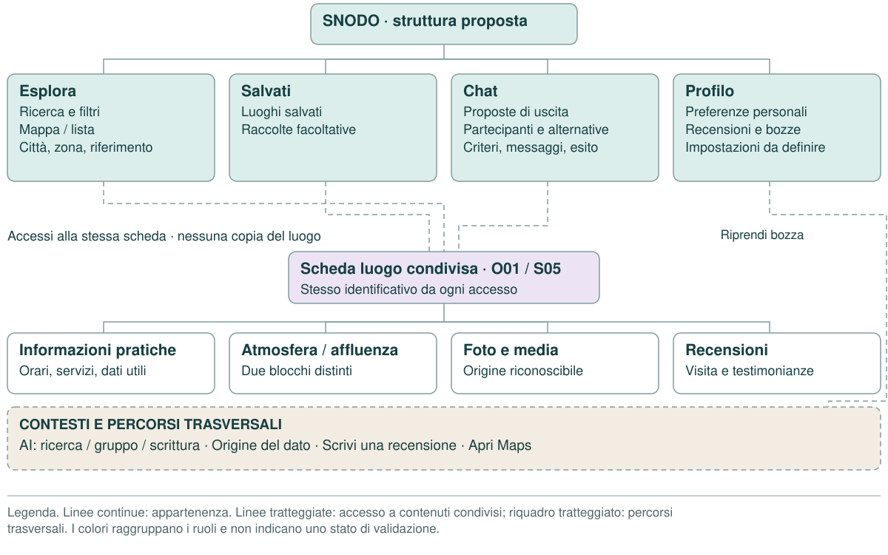
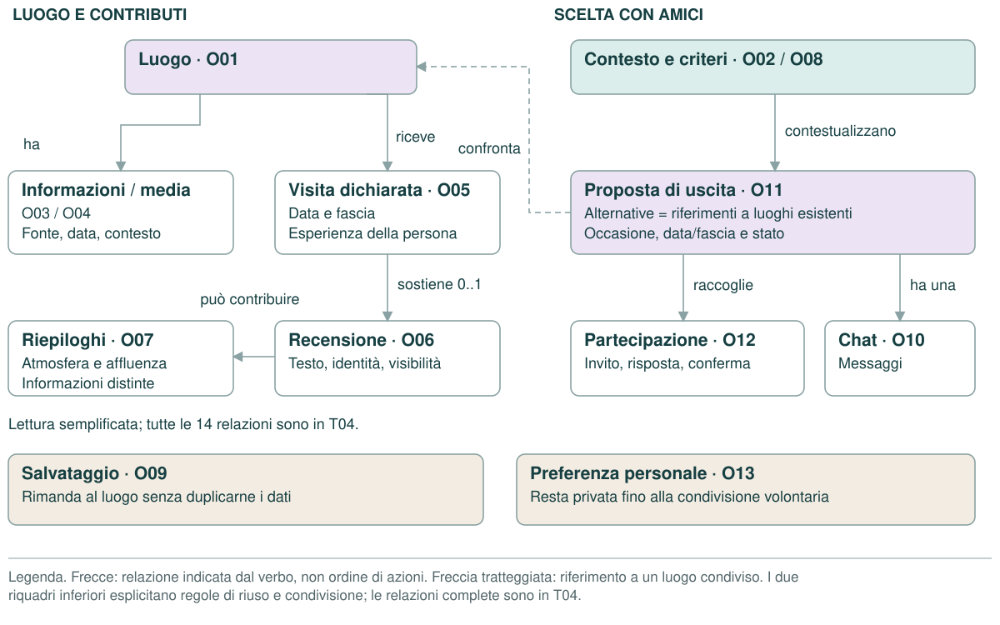
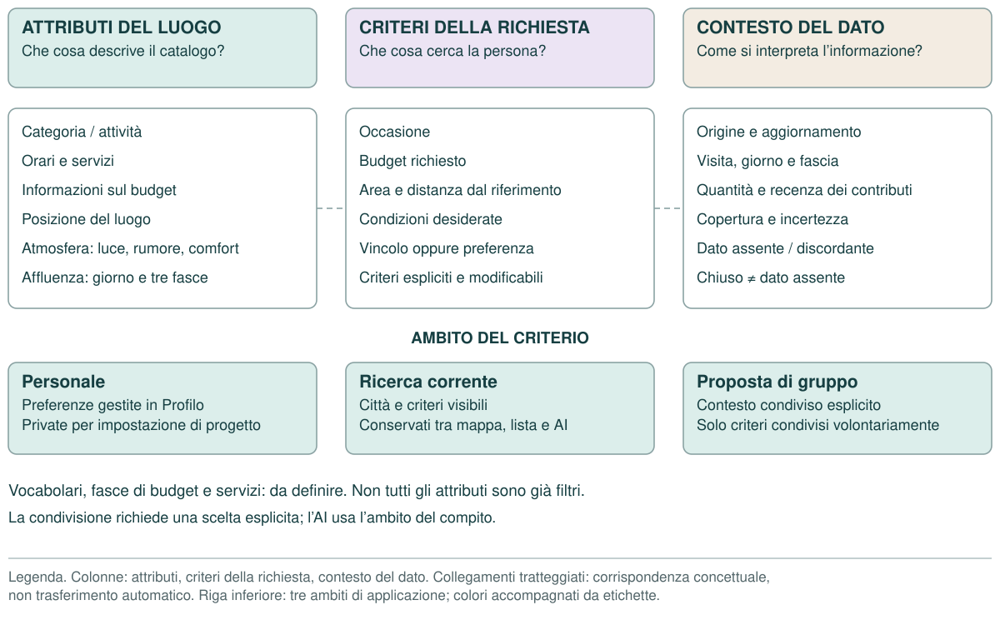

# Architettura delle informazioni di SNODO
Versione 1.0 · 11 ottobre 2026
Dossier di progetto: tavole, legende, tabelle e riferimenti.

## Architettura delle informazioni · SNODO

L’architettura delle informazioni di Snodo organizza la ricerca e la valutazione dei luoghi, la scelta con amici e il racconto di una visita. Il dossier distingue la struttura di navigazione dalle relazioni tra i contenuti e dai criteri che ne consentono la ricerca. La scheda luogo è il punto di riferimento comune dei diversi accessi.
Copertura iniziale Italia: confermata nel brief. Quattro aree, etichette, gerarchie, cardinalità e condizioni dell’accordo: ipotesi progettuali da verificare. Pattern Atmosfera e affluenza v0.4: approvato dal committente per l’integrazione, senza equivalere a validazione con utenti. Catalogo e valori del prototipo: dimostrativi. Questa consegna non attesta test reali o componenti nativi Figma.

**Come leggere il dossier**
- Tavola 01: aree e contenuti; T01-T02 descrivono appartenenza e trasversalità.
- Tavola 02: oggetti e relazioni; T03-T04 specificano campi e cardinalità.
- Tavola 03: classificazione; T05-T08 descrivono criteri, etichette, provenienza e stati.
- T09-T11: corrispondenza delle schermate, regole e verifica prevista.

**Legenda degli identificativi:** O = oggetto informativo; S = schermata/stato; C = responsabilità funzionale IA; DS = componente del design system; F1/F2/F3 = flussi individuale/gruppo/contributo; T = tabella del dossier. C e DS sono namespace distinti.

## 01 · Mappa delle aree e dei contenuti

La mappa rappresenta appartenenza e riuso dei contenuti. I passaggi operativi e le alternative restano nei user flow.

**Legenda:** Linee continue: appartenenza. Linee tratteggiate: accesso a contenuti condivisi; riquadro tratteggiato: percorsi trasversali. I colori raggruppano i ruoli e non indicano uno stato di validazione.

## Aree, contesti e strumenti

### T01_Aree · Aree principali e contenuti

| Area | Contenuti organizzati | Accessi e collegamenti | Schermate |
| --- | --- | --- | --- |
| Esplora | Ricerca dei luoghi; mappa/lista; scheda con informazioni pratiche, atmosfera, affluenza, media e recensioni. | Città e zona modificabili; filtri; accesso alla stessa scheda da tutti i percorsi. | S01-S08 |
| Salvati | Luoghi salvati; eventuale raccolta come raggruppamento facoltativo. | Apre la scheda esistente; consente di avviare una proposta di uscita. | S19 → S05/S12 |
| Chat | Proposte di uscita; partecipanti; criteri condivisi; alternative; messaggi e stato dell’accordo. | Conversazioni circoscritte alla proposta. L’etichetta Chat va verificata rispetto a questo contenuto. | S11-S14 |
| Profilo | Preferenze personali, recensioni/contributi, bozze e impostazioni essenziali previste dal brief. | Ripresa delle bozze e controllo della visibilità. Dettaglio delle impostazioni da definire. | S20 → S15-S17 |

Le quattro destinazioni sono una proposta di navigazione. Mappa e lista sono due viste degli stessi risultati; la scheda luogo è un contenuto condiviso.

### T02_Trasversali · Contesti, strumenti e percorsi trasversali

| Elemento | Ruolo nell’architettura | Regola di continuità | Riferimenti |
| --- | --- | --- | --- |
| Città e zona | Contesto geografico della ricerca e della proposta. | Scelta manuale disponibile; il GPS è facoltativo; una proposta ha un contesto condiviso esplicito. | O02; S01-S04/S10/S12-S14 |
| Ricerca e filtri | Accesso ai luoghi per criteri espliciti. | Distinguere vincoli e preferenze; conservare i criteri tra mappa, lista e assistente. | O08; S02-S04/S10 |
| Assistente AI | Supporto alla ricerca, alla proposta di gruppo e alla scrittura. | Rimanda agli stessi luoghi; usa i criteri visibili/condivisi; propone testo senza applicarlo o inviarlo da solo. | S10/S13/S16 |
| Origine del dato | Approfondimento della provenienza e dei limiti. | Accessibile dal dato pertinente; ritorno al luogo, alla ricerca o alla proposta di origine. | S09; C15 |
| Scrivi una recensione | Percorso di creazione di un contributo legato al luogo. | Visita dichiarata, bozza, eventuale aiuto AI, anteprima e invio esplicito; bozze in Profilo. | S15-S18; O05/O06 |
| Apri Maps | Uscita verso un servizio esterno di navigazione. | Conservare il contesto al ritorno; percorso disponibile anche da esito di gruppo provvisorio. | S21 da S05/S14 |

## 02 · Mappa delle relazioni informative

Il modello concettuale descrive che cosa esiste nell’app e come gli oggetti si collegano. Le frecce non descrivono un percorso dell’utente.

**Legenda:** Frecce: relazione indicata dal verbo, non ordine di azioni. Freccia tratteggiata: riferimento a un luogo condiviso. I due riquadri inferiori esplicitano regole di riuso e condivisione; le relazioni complete sono in T04.

## Oggetti informativi · luogo e contributi

### T03_Oggetti · Dizionario degli oggetti informativi

| ID | Oggetto | Informazioni essenziali | Regola di organizzazione |
| --- | --- | --- | --- |
| O01 | Luogo | id; città; zona; posizione; categoria; informazioni pratiche | Unico ID da mappa/lista/AI/salvati/gruppo |
| O02 | Contesto geografico | città; zona; riferimento distanze; origine manuale/posizione autorizzata | Ricerca altrove senza GPS; copertura Italia |
| O03 | Informazione sul luogo | tipo; valore o assente; fonte; aggiornamento; contesto temporale | Dichiarazione/contributo/riepilogo distinti |
| O04 | Media | tipo; origine; data; contesto | Locale/utente etichettati; origine non certifica veridicità |
| O05 | Visita dichiarata | luogo_id; data; fascia; occasione facoltativa | Dichiarata dalla persona; nessun rilevamento obbligatorio |
| O06 | Recensione | visita; risposte; appunti; testo applicato; visibilità; identità mostrata; stato | AI suggerisce; autore applica e invia esplicitamente |
| O07 | Indicatore atmosfera | Dimensione, periodo, intensità, contributi, recenza e incertezza; affluenza: giorno e tre fasce con intervalli e livelli. | Atmosfera (luce, rumore, comfort) distinta dall’affluenza; valori demo, assenze esplicite; nessun indice unico o dato live. |

O01-O13 riprendono gli ID del modello esistente. O07 è approfondito con il pattern Atmosfera e affluenza v0.4: l’affluenza è un sotto-oggetto distinto, senza inventare un nuovo ID ufficiale. I campi descrivono responsabilità informative, non uno schema di database definitivo.

## Oggetti informativi · criteri e scelta condivisa

Approfondimento O07: atmosfera e affluenza appartengono ai riepiloghi del luogo, ma mantengono campi, contesti e stati distinti. Il selettore del giorno aggiorna solo l’affluenza. Il metodo di raccolta e aggregazione del prodotto reale deve ancora essere definito.

### T03_Oggetti · Dizionario degli oggetti informativi

| ID | Oggetto | Informazioni essenziali | Regola di organizzazione |
| --- | --- | --- | --- |
| O08 | Criterio | dimensione; valore; vincolo/preferenza; origine; area di applicazione | Correggibile; AI non allenta un vincolo da sola |
| O09 | Salvataggio | luogo_id; raccolta facoltativa | Collegamento; non duplica dati del luogo |
| O10 | Conversazione | contesto; messaggi; autori; invocazioni AI | AI individuale o chat di una proposta; nessun feed |
| O11 | Proposta di uscita | città/zona; occasione; data/fascia; alternative; risposte; stato | Decisione umana; cambi importanti richiedono riconferma |
| O12 | Partecipazione | invito; adesione; vincoli condivisi; preferenza; conferma | Invito/adesione/preferenza/accordo non coincidono |
| O13 | Preferenza personale | criterio esplicito; modifica | Privata finché non condivisa volontariamente |

O01-O13 riprendono gli ID del modello esistente. O07 è approfondito con il pattern Atmosfera e affluenza v0.4: l’affluenza è un sotto-oggetto distinto, senza inventare un nuovo ID ufficiale. I campi descrivono responsabilità informative, non uno schema di database definitivo.

## Relazioni complete e cardinalità

### T04_Relazioni · Relazioni e cardinalità proposte

| Origine | Relazione | Destinazione | Cardinalità |
| --- | --- | --- | --- |
| O01 · Luogo | ha informazioni | O03 · Informazione sul luogo | 1:N |
| O01 · Luogo | ha media | O04 · Media | 1:N |
| O01 · Luogo | riceve visite dichiarate | O05 · Visita dichiarata | 1:N |
| O05 · Visita dichiarata | sostiene contributo | O06 · Recensione | 1:0..1 |
| O06 · Recensione | Può alimentare un riepilogo; metodo di aggregazione ancora da definire. | O07 · Indicatore atmosfera | N:N |
| O02 · Contesto geografico | definisce area/riferimento dei criteri | O08 · Criterio | 1:N |
| O08 · Criterio | filtra o descrive compatibilità, anche incerta | O01 · Luogo | N:N |
| O09 · Salvataggio | riferisce senza copia | O01 · Luogo | N:1 |
| O10 · Conversazione | chat associata alla proposta | O11 · Proposta di uscita | 1:0..1 |
| O11 · Proposta di uscita | confronta alternative | O01 · Luogo | N:N |
| O11 · Proposta di uscita | raccoglie stati delle persone | O12 · Partecipazione | 1:N |
| O12 · Partecipazione | condivide criteri volontari | O08 · Criterio | 1:N |
| O11 · Proposta di uscita | ha contesto condiviso esplicito | O02 · Contesto geografico | N:1 |
| O13 · Preferenza personale | conserva criterio personale | O08 · Criterio | 1:1 |

1:N = un oggetto collegato a molti; N:1 = molti riferimenti a un oggetto; N:N = molti a molti; 1:0..1 = collegamento facoltativo a un solo oggetto. Sono cardinalità del modello di lavoro, da verificare in implementazione. La tavola 02 ne mostra una selezione per la lettura, questa tabella le riporta tutte.

## 03 · Classificazione e ambiti dei criteri

Un attributo descrive un luogo; un criterio esprime una richiesta; i metadati ne rendono possibile una lettura situata. Questa distinzione guida scheda, filtri e assistente.

**Legenda:** Colonne: attributi, criteri della richiesta, contesto del dato. Collegamenti tratteggiati: corrispondenza concettuale, non trasferimento automatico. Riga inferiore: tre ambiti di applicazione; colori accompagnati da etichette.

## Criteri di organizzazione e ricerca

### T05_Criteri · Classificazione, filtri e contesto

| Dimensione | Informazioni o valori | Dove si applica | Regola / stato della definizione |
| --- | --- | --- | --- |
| Geografia | Città/comune, zona, posizione e origine del contesto. | Esplora; assistente; proposta. | Copertura Italia confermata. Scelta manuale ammessa; confini e dizionario delle zone da definire. |
| Categoria / attività | Tipo di luogo o attività proposta. | Catalogo; ricerca; confronto. | Vocabolario controllato da definire e verificare. Nessun elenco di categorie è approvato da questa tavola. |
| Occasione | Contesto d’uso dichiarato dalla persona o dal gruppo. | Filtri; assistente; proposta. | È un criterio della richiesta; non implica una qualità universale del luogo. Etichette da verificare. |
| Budget | Limite o preferenza di spesa. | Ricerca; scheda; proposta. | Unità, fasce e cosa comprende il prezzo da definire; dato mancante distinto dal rispetto del budget. |
| Distanza | Distanza dal riferimento esplicito scelto. | Risultati; scheda; confronto. | Riferimento visibile. Non trasformare distanza in durata o ottimizzazione dei tragitti. |
| Servizi / dati pratici | Orari, disponibilità e caratteristiche documentate. | Scheda; filtri ove supportati. | Valori e fonti tracciabili; un servizio non documentato resta non verificato. Vocabolario da definire. |
| Atmosfera | Luce, rumore, comfort: intensità 1-5 e contesto dei contributi. | S05/S06; criteri pertinenti. | Pattern v0.4: comfort soggettivo; intensità non equivale a gradimento; periodo e limiti visibili. |
| Affluenza | Giorno; tre fasce con nome, intervallo e livello Bassa/Media/Alta. | S05/S06; approfondimento. | Intervalli coerenti con l’apertura; selezione del giorno modifica solo l’affluenza. Filtro specifico non definito. |
| Forza del criterio | Vincolo obbligatorio oppure preferenza. | Filtri; assistente; proposta. | Criterio correggibile; l’AI non allenta un vincolo senza una scelta esplicita della persona. |
| Ambito del criterio | Personale, ricerca corrente o condiviso nella proposta. | Profilo; ricerca; gruppo. | Le preferenze private diventano condivise solo per scelta della persona. |
| Contenuti personali | Salvataggi; raccolta facoltativa; bozze e contributi. | Salvati; Profilo. | Luoghi collegati senza duplicazione. Raccolte e gestione dei contributi da dettagliare nei flussi. |

La tabella separa attributi del luogo, criteri della richiesta e contesti di lettura. Non ogni dato della scheda è già un filtro. Gli intervalli demo 16-18, 18-21 e 21-23 esemplificano un luogo aperto 16-23: non sono fasce universali del prodotto.

## Etichette e significati

### T06_Etichette · Etichette e significati da verificare

| Etichetta | Significato per la persona | Posizione / collegamento | Nota editoriale |
| --- | --- | --- | --- |
| Esplora | Cerca e valuta luoghi nell’area scelta. | Destinazione principale. | Etichetta di lavoro già presente. |
| Salvati | Riprendi i luoghi che hai conservato. | Destinazione principale. | Esplicita il contenuto; raccolte facoltative. |
| Chat | Riprendi una proposta e confrontati con gli invitati. | Destinazione principale. | Verificare se fa pensare a una chat generale; alternativa da testare: Uscite. |
| Profilo | Gestisci preferenze, bozze e contributi personali. | Destinazione principale. | Verificare la reperibilità delle bozze sotto questa etichetta. |
| Atmosfera | Leggi luce, rumore e comfort nel contesto dei contributi. | Scheda luogo; dettaglio. | Affluenza presentata separatamente. |
| Affluenza | Confronta i livelli disponibili per giorno e fascia. | Scheda luogo; dettaglio. | Evita parole che facciano intendere una misurazione in tempo reale. |
| Origine del dato | Comprendi chi fornisce l’informazione e quanto è aggiornata. | Approfondimento trasversale. | Nome descrittivo; etichetta visibile da verificare. |
| Scrivi una recensione | Racconta una visita e controlla il contributo prima dell’invio. | Azione dalla scheda; ripresa da Profilo. | Azione, non nuova destinazione principale. |
| Preferenza / Conferma | Esprimi un orientamento / accetta la decisione proposta. | Proposta di gruppo. | Due concetti e azioni distinti. |
| Apri Maps | Passa a un navigatore esterno. | Scheda luogo; esito della proposta. | Segnala l’uscita e consente il ritorno al contesto. |

Le etichette qui descritte sono proposte editoriali o nomi di lavoro: non attestano una modifica già applicata all’interfaccia.

## Provenienza e qualità delle informazioni

### T07_Provenienza · Provenienza, lettura e trasformazione delle informazioni

| Tipo | Metadati da mantenere | Come leggerlo | Cosa non inferire |
| --- | --- | --- | --- |
| Informazione dichiarata dal luogo | Origine; aggiornamento disponibile; campo a cui si riferisce. | Dichiarazione attribuita al locale. | La fonte non è una certificazione automatica di accuratezza. |
| Contributo di una persona | Autore/identità mostrata; visita dichiarata; data/fascia; testo e visibilità. | Esperienza situata e giudizio personale. | Una testimonianza non descrive ogni visita o ogni persona. |
| Media | Origine locale/utente; data e contesto quando disponibili. | Immagine con provenienza riconoscibile. | Una foto non garantisce le condizioni attuali del luogo. |
| Riepilogo di atmosfera o affluenza | Dimensione; periodo/giorno/fascia; quantità, recenza, copertura e incertezza. | Sintesi distinta dai contributi individuali; demo esplicita nel prototipo. | Nessuna misura live, comfort universale o aggregazione reale già dimostrata. |
| Risultato o suggerimento AI | Criteri utilizzati; luoghi del catalogo; corrispondenze, fonti e dati mancanti. | Trasformazione o suggerimento che si può correggere. | L’AI non è una fonte indipendente e non conferma per conto delle persone. |
| Dato assente / discordante | Campo interessato; motivo disponibile; fonti discordanti; limiti. | Assenza o incertezza esplicita, con accesso al dettaglio pertinente. | Non equivale a zero, Bassa o criterio soddisfatto. |

## Stati, partecipazione e accordo

### T08_Stati · Stati informativi da distinguere

| Ambito | Stati / condizioni | Presentazione e conseguenza | Riferimenti |
| --- | --- | --- | --- |
| Ricerca | Risultati / nessun risultato / errore. | Nessun risultato: modificare esplicitamente i criteri. Errore: recupero senza cancellare contesto. | S02-S04/S10 |
| Dato sul luogo | Disponibile / parziale / assente / vecchio / discordante. | Mostrare copertura, contesto e limiti; la qualità del dato non coincide con il giudizio sul luogo. | S05/S06/S09 |
| Affluenza | Livello disponibile / dato assente / fascia chiusa. | Bassa, Media, Alta solo per dato disponibile. Chiuso è distinto da Dato assente. | S05/S06; DS19 |
| Invito | Pendente / accettato / declinato / errato o scaduto. | Invito pendente non è un voto; declinato resta visibile, non vota e non blocca. | S12/S13 |
| Risposta del partecipante | Adesione / preferenza / conferma / contestazione. | Aderire non conferma una scelta; preferire un’alternativa non equivale a confermare l’accordo. | S13/S14 |
| Esito della proposta | Provvisorio / concordato / contestato. | Concordato nel modello di lavoro: aderenti confermati e nessun invito pendente; il silenzio non è consenso. | S14 |
| Modifica della proposta | Cambio rilevante di luogo, contesto o criteri. | Riaprire la decisione e richiedere riconferma; conservare il contesto leggibile. | S13/S14 |
| Recensione | Bozza / suggerimento AI / testo applicato / anteprima / invio / esito. | Suggerimento separato fino all’applicazione; visibilità e identità controllate prima dell’invio esplicito. | S15-S18/S20 |
| Invio del contributo | Attesa / successo / fallimento. | Feedback distinguibile; conservare bozza; recupero senza doppio invio. | S17/S18 |

Questi sono stati e regole del modello, non nuove voci di navigazione. Le condizioni di accordo di gruppo sono ipotesi progettuali da testare.

## Appendice · inventario delle schermate

### T09_Schermate · Corrispondenza con le 21 schermate

| ID | Schermata esistente | Area / percorso | Ruolo informativo | Flusso |
| --- | --- | --- | --- | --- |
| S01 | Avvio/città e zona | Esplora | Contesto / avvio | F1 |
| S02 | Esplora mappa | Esplora | Vista risultati | F1 |
| S03 | Ricerca/lista | Esplora | Vista risultati | F1 |
| S04 | Filtri | Esplora | Strumento / pannello | F1, F2 |
| S05 | Scheda su mappa | Esplora | Contenuto condiviso | F1, F2, F3 |
| S06 | Atmosfera | Esplora | Approfondimento | F1 |
| S07 | Galleria/viewer | Esplora | Approfondimento / viewer | F1 |
| S08 | Recensioni/dettaglio | Esplora | Approfondimento | F1 |
| S09 | Origine/nota sul dato | Trasversale | Approfondimento trasversale | F1, F2 |
| S10 | Assistente individuale | AI trasversale | Supporto trasversale | F1 |
| S11 | Chat/proposte | Chat | Destinazione / elenco | F2 |
| S12 | Crea proposta/invita | Chat | Creazione / inviti | F2 |
| S13 | Proposta di gruppo | Chat | Contenuto proposta | F2 |
| S14 | Esito condiviso | Chat | Stato / riepilogo | F2 |
| S15 | Recensione guidata | Contributo | Creazione contributo | F3 |
| S16 | Testo/aiuto AI | Contributo | Composizione / aiuto | F3 |
| S17 | Anteprima/visibilità | Contributo | Controllo / anteprima | F3 |
| S18 | Esito contributo | Contributo | Esito invio | F3 |
| S19 | Salvati | Salvati | Destinazione / elenco | F1, F2 |
| S20 | Profilo/bozze | Profilo | Destinazione / gestione | F3 |
| S21 | Uscita e ritorno Maps | Trasversale | Passaggio esterno | F1, F2 |

F1 = scegliere individualmente; F2 = scegliere con amici; F3 = raccontare una visita. Gli ID non sono modificati. Uno schermo può rappresentare una vista, un pannello o uno stato: 21 schermate non significano 21 destinazioni principali.

## Regole di coerenza

### T10_Regole · Regole di coerenza dell’architettura

| Regola | Applicazione concreta | Perché conta |
| --- | --- | --- |
| Un luogo, più accessi | Mappa, lista, Salvati, AI e proposta aprono O01/S05 con lo stesso identificativo. | Evita copie divergenti della scheda. |
| Contesto geografico esplicito | Città, zona e riferimento delle distanze restano riconoscibili; altra città ricercabile senza GPS. | Rende interpretabili i risultati e le distanze. |
| Criteri leggibili e correggibili | Mostrare dimensione, valore, vincolo/preferenza, origine e ambito. | La persona comprende e corregge la ricerca. |
| Preferenze personali sotto controllo | Il gruppo riceve solo i criteri condivisi volontariamente. | Mantiene distinta la gestione individuale da quella collettiva. |
| AI contestuale | Ricerca: criteri visibili. Gruppo: criteri condivisi. Recensione: materiale fornito dall’autore. | Il suggerimento resta collegato al compito. |
| Atmosfera e affluenza distinte | Luce/rumore/comfort separati dai livelli per giorno e tre fasce. | Non confonde intensità, gradimento e presenza di persone. |
| Provenienza vicino al dato | Origine, aggiornamento e limiti accessibili dal campo o dal riepilogo pertinente. | Aiuta a valutare l’informazione prima della scelta. |
| Stati di gruppo distinti | Invito, adesione, preferenza e conferma hanno significati separati. | Evita di presentare una decisione come condivisa senza accordo. |
| Creazione e pubblicazione separate | Bozza → eventuale suggerimento → applicazione → anteprima → invio esplicito. | L’autore controlla testo, identità e destinatari. |
| Ritorno con continuità | Chiudere dettaglio/assistente o rientrare da Maps conserva luogo, area, criteri e proposta pertinenti. | Permette di riprendere il compito senza ricostruirlo. |

## Verifica prevista

Controlli della consegna: corrispondenza degli ID con il modello esistente, copertura delle 21 schermate e delle 14 relazioni, integrità dei collegamenti locali e verifica visiva del PDF. Questi controlli riguardano i materiali; le prove con persone restano da eseguire.

### T11_Verifica · Verifica prevista della struttura e delle etichette

| Compito / domanda | Metodo proposto | Cosa osservare |
| --- | --- | --- |
| Dove cercheresti un luogo? Dove cambieresti città? | Tree test o ricerca nel prototipo. | Prima destinazione scelta, errori, aiuti e comprensione dell’area. |
| Dove ritroveresti un luogo salvato o una recensione incompleta? | Tree test su Salvati e Profilo. | Reperibilità dei contenuti personali e significato di Bozza. |
| Che cosa ti aspetti nella sezione Chat? | Interpretazione dell’etichetta e confronto con Uscite. | Aspettativa di chat generale oppure proposta circoscritta. |
| Che differenza vedi tra atmosfera e affluenza? | Lettura di S05/S06 con casi completi e mancanti. | Distinzione tra intensità, percezione, giorno/fascia, assenza e chiusura. |
| Il gruppo ha deciso? Chi manca? | Scenario con invito pendente, preferenza e conferma. | Comprensione di stato provvisorio e condizioni di accordo. |
| Quali informazioni usa l’assistente? | Scenario individuale, di gruppo e di recensione. | Criteri riconosciuti, correzioni, distinzione tra suggerimento e decisione/invio. |

È un protocollo proposto, non un risultato. I test formativi previsti nel brief coinvolgono le stesse tre persone già intervistate: dichiarare la familiarità con il progetto e registrare osservazioni individuali. Non sono una validazione indipendente o rappresentativa.

## Testo per la tesi e fonti di progetto

La proposta di architettura delle informazioni di Snodo articola il sistema in quattro aree principali: Esplora, Salvati, Chat e Profilo. I diversi punti di accesso rimandano a un unico oggetto luogo, evitando la duplicazione delle informazioni tra ricerca, assistente e proposte di gruppo. La classificazione distingue gli attributi del luogo dai criteri della richiesta e dai metadati necessari a interpretare i contributi. Città e zona costituiscono il contesto della ricerca; vincoli e preferenze sono espliciti e correggibili. L’assistente opera nei contesti di ricerca, decisione di gruppo e scrittura, mantenendo il controllo delle scelte alle persone. La struttura e le etichette sono ipotesi progettuali da verificare attraverso prove formative di reperibilità e comprensione.

Il testo è utilizzabile come proposta progettuale; aggiornare i tempi verbali soltanto dopo avere svolto e documentato le verifiche.

### Fonti locali
- F01 · Brief confermato — Perimetro Italia, quattro aree proposte, ruolo AI e test formativi.
- F02 · Analisi del progetto e requisiti — Contenuti per area, criteri, flussi e limiti del progetto.
- F03 · [Architettura generale](../Architettura_generale.md) — Oggetti O01-O13, relazioni e invarianti.
- F04 · [Modello oggetti e relazioni](../Architettura_oggetti_relazioni.json) — ID e cardinalità del modello di lavoro.
- F05 · [Inventario schermate](../Inventario_schermate.json) — ID S01-S21, nomi, aree e appartenenza ai flussi.
- F06 · [Atmosfera e affluenza v0.4](../../06_design_system/Atmosfera_affluenza.md) — Aggiornamento: luce, rumore, comfort; affluenza distinta in tre fasce; assenze.
- F07 · [Corrispondenza IA e design system](../../06_design_system/Corrispondenza_componenti_IA_DS.md) — Namespace C/DS distinti; C12 usa DS08 e DS19.

**Nota di revisione:** il pattern v0.4 dettaglia O07 rispetto all’architettura iniziale. L’aggiornamento è recepito in questo dossier; non riscrive retroattivamente gli asset precedenti.
