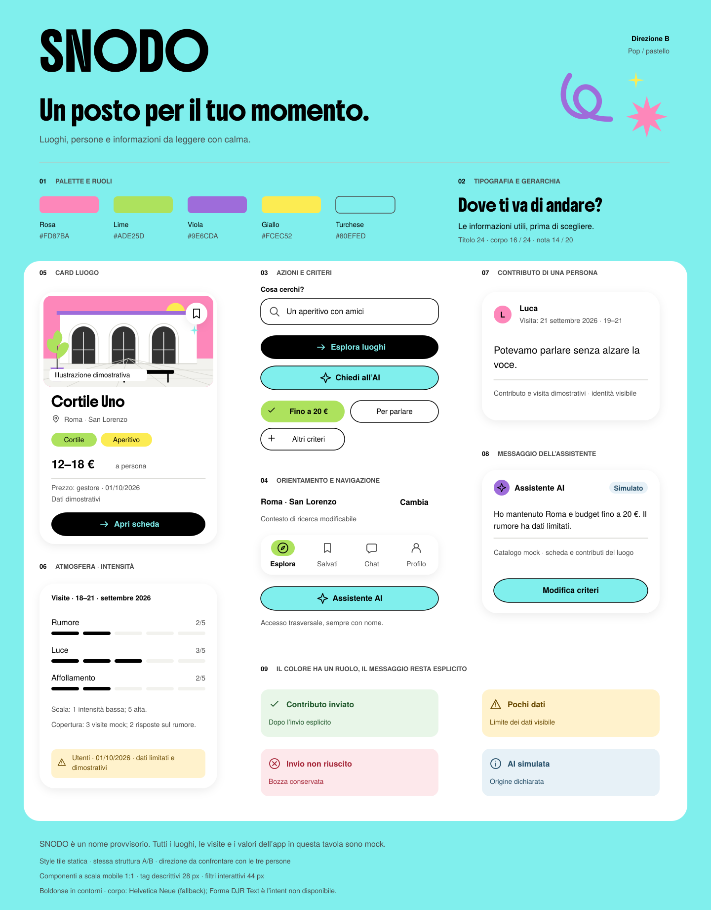
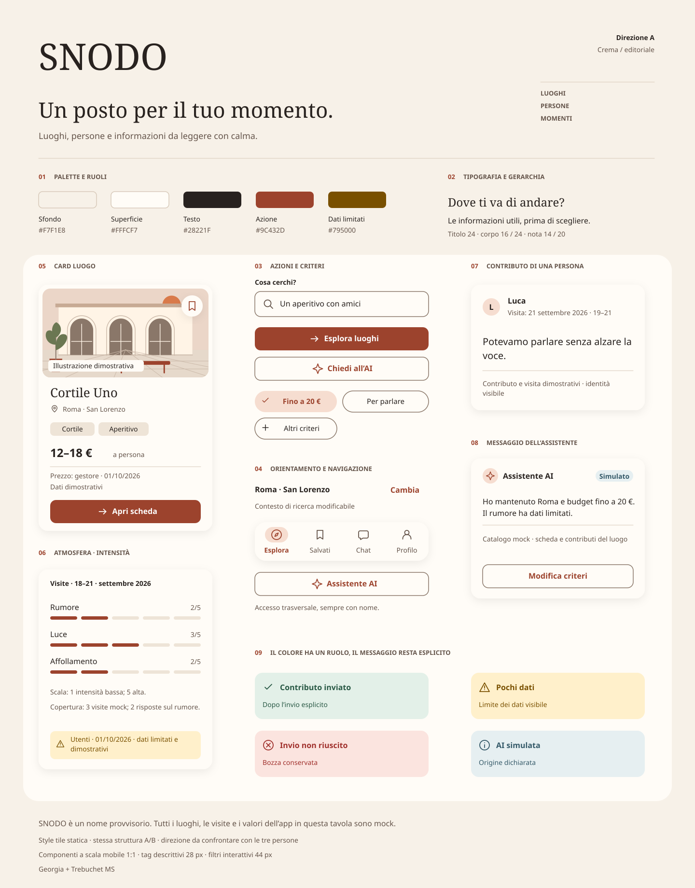

# Style tile correnti: Pop e Calda con Mali

Pop (B) è lo stile principale di SNODO. Calda (A) è l’alternativa scelta dall’autore con **Mali SemiBold 600** nei titoli brevi. Sito, prototipo e catalogo componenti usano queste due direzioni; le prove tipografiche precedenti sono conservate in archivio. Nessuna scelta è attribuita a test con partecipanti.

## Le due direzioni correnti

| Direzione | Titoli | Palette | Uso |
|---|---|---|---|
| Pop · B | Boldonse 400 | Turchese #80EFED, rosa #FD87BA, verde #ADE25D, viola #9E6CDA, giallo #FCEC52 | Stile principale |
| Calda · A | Mali SemiBold 600 | Crema #F6EDE0, verde scuro #022E21, prugna #33173A | Alternativa selezionabile |

Per entrambe il corpo previsto è Forma DJR Text. Le anteprime usano Helvetica Neue perché Forma DJR Text non è disponibile nel workspace. Titoli, testi funzionali, recensioni e dati hanno ruoli distinti: il handwritten serve ai titoli, il sans serif alla lettura continua e ai controlli.

## Pop: stile principale

[Scarica SVG Pop](Style_tile_B.svg) · [Scarica PNG Pop](Style_tile_B.png) · [Prova Pop](../07_prototipo/index.html?screen=S02&theme=B).

La tavola Pop mantiene la base Boldonse e gli accenti della proposta personale. I componenti del catalogo e il prototipo mostrano le integrazioni più recenti: preview della recensione, mappa aperta, fotografie e galleria con provenienza. La tavola statica non rappresenta tutte le schermate o tutti gli stati.

## Calda: Mali SemiBold 600

[Scarica SVG Calda](Style_tile_A.svg) · [Scarica PNG Calda](Style_tile_A.png) · [Prova Calda](../07_prototipo/index.html?screen=S02&theme=A) · [Componenti Calda](../06_design_system/index.html?theme=A).

La tavola corrente misura **1560 × 1160 px** e sostituisce la precedente Calda editoriale. Contiene palette, tipografia, segni decorativi leggeri, pulsanti, tag, card con recensione e un esempio di dettaglio con fotografie del locale e degli utenti. La tavola illustra la provenienza delle fotografie: nel prototipo la galleria riunisce i contributi con etichette di origine.

Il fondo crema ospita testo verde scuro; il prugna distingue l’azione primaria. Le superfici di lettura sono #FFFCF7, il testo secondario #335449. Mali resta nel peso 600, con interlinea 1,35 e senza spaziatura artificiale tra lettere. Per componenti e stati usare i token aggiornati, non ricavare misure dalla tavola ingrandita.

Le fotografie sono stock illustrative. Luoghi, nomi, prezzi, date, contributi e valori mostrati sono mock; non costituiscono dati della ricerca né informazioni su attività reali. [Crediti delle fotografie](../07_prototipo/media/Crediti_fotografie.html).

## Come usare i materiali in Figma

1. Importare gli SVG alle dimensioni originali. Le tavole hanno formati diversi: confrontare i componenti alla stessa scala, evitando di adattare entrambe alla stessa larghezza per giudicare il testo.
2. Per i titoli Pop usare [Boldonse](fonts/Boldonse-Regular.ttf), per Calda [Mali SemiBold 600](fonts/Mali-SemiBold.ttf). Le licenze OFL sono incluse: [Boldonse](fonts/OFL.txt) e [Mali](fonts/Mali-OFL.txt).
3. Nelle style tile i titoli sono contorni vettoriali; per editarli come testo, ricrearli con il font. Negli SVG dei componenti il testo è conservato come testo, con font incorporati per l’anteprima web: verificare comunque l’importazione effettiva in Figma.
4. Aprire il [catalogo](../06_design_system/index.html), scegliere stile, componente e variante, quindi scaricare il relativo SVG. Lo [ZIP dei componenti](../06_design_system/svg/SNODO-componenti-SVG.zip) contiene 122 visuali nelle due direzioni.
5. Costruire componenti nativi, varianti e Auto Layout; collegare i percorsi e verificare testi lunghi, focus, ritorni e stati senza dati. L’importazione di un SVG non costruisce un prototipo interattivo.

## Verifica e confronto con le persone

I [contrasti correnti](../06_design_system/Contrasti.html) e il [registro dell’aggiornamento Mali](../06_design_system/QA_Calda_Mali.json) descrivono controlli tecnici, non una certificazione WCAG completa. Il [protocollo del confronto](Protocollo_confronto.html) e la [scheda risposte vuota](Risposte_style_tiles.csv) servono a raccogliere preferenze e motivazioni. Prima delle sessioni, preparare lo stesso contenuto nei due stili alla stessa scala: le due tavole correnti hanno composizioni diverse e non costituiscono da sole uno stimolo controllato.

## Archivio delle esplorazioni

Queste pagine documentano proposte precedenti e alternative scartate. Non definiscono i font o i colori correnti del progetto:

- [Calda Pop](Proposta_Calda_Pop.html).
- [Caveat e Patrick Hand](Proposta_Calda_Handwritten.html).
- [Fraunces e Shantell Sans](Alternative_tipografiche_Calda.html).
- [Kalam e Handlee](Confronto_Kalam_Handlee.html).
- [Mali e Coming Soon](Confronto_Mali_ComingSoon.html): confronto da cui è stato scelto Mali 600.

La tile Calda corrente deriva da build_mali_comingsoon.py; build_style_tiles.py conserva il precedente impianto a nove componenti e non deve sovrascrivere i token o la tile aggiornata.
