# Grafici dei questionari

I grafici riportano i risultati descrittivi dei due questionari: 50 risposte nel primo e 33 nel secondo. I campioni non sono appaiati e non consentono di generalizzare i risultati alla popolazione italiana. Le percentuali mantengono la propria base di calcolo; nelle domande a risposta multipla non devono sommare al 100%.

## Grafico sondaggio S01 — Chi ha risposto ai due questionari

**Collocazione:** 1.3 — Metodo. **Natura:** risultato del questionario.

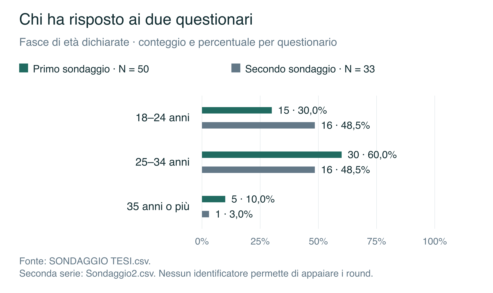

**Didascalia.** Distribuzione per età: 50 risposte nel primo questionario e 33 nel secondo. I gruppi non sono appaiati.

**Fonte.** Elaborazione dei dati di SONDAGGIO TESI.csv.

Seconda serie: Sondaggio2.csv. Nessun identificatore permette di appaiare i round.

[Figura in SVG](grafici_ricerca/S01.svg) · [Figura in PNG](grafici_ricerca/S01.png)

## Grafico sondaggio S02 — Studiare e lavorare a casa sono preferenze diffuse

**Collocazione:** 2.1 — Primo questionario. **Natura:** risultato del questionario.

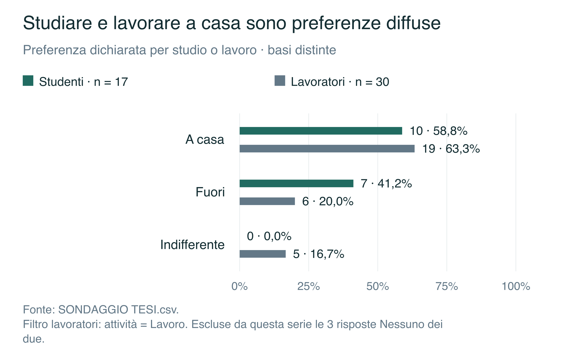

**Didascalia.** Preferiscono la casa 10/17 studenti (58,8%) e 19/30 lavoratori (63,3%). Le domande riguardano attività differenti.

**Fonte.** Elaborazione dei dati di SONDAGGIO TESI.csv.

Filtro lavoratori: attività = Lavoro. Escluse da questa serie le 3 risposte Nessuno dei due.

[Figura in SVG](grafici_ricerca/S02.svg) · [Figura in PNG](grafici_ricerca/S02.png)

## Grafico sondaggio S03 — Come viene valutata la flessibilità degli spazi

**Collocazione:** 2.1 — Primo questionario. **Natura:** risultato del questionario.

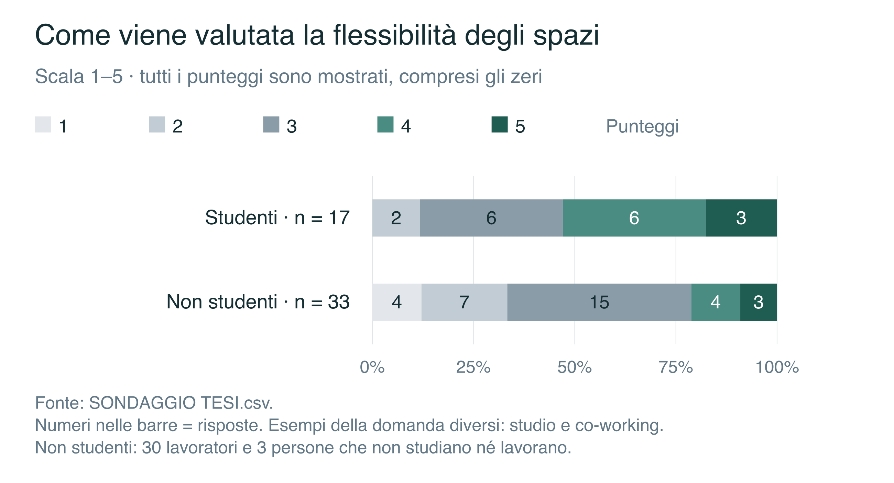

**Didascalia.** Distribuzioni della valutazione di flessibilità nei due rami del primo questionario. Non sono coorti generazionali.

**Fonte.** Elaborazione dei dati di SONDAGGIO TESI.csv.

Numeri nelle barre = risposte. Esempi della domanda diversi: studio e co-working. Non studenti: 30 lavoratori e 3 persone che non studiano né lavorano.

[Figura in SVG](grafici_ricerca/S03.svg) · [Figura in PNG](grafici_ricerca/S03.png)

## Grafico sondaggio S04 — Atmosfera, distanza e budget orientano la scelta

**Collocazione:** 2.1 — Primo questionario. **Natura:** risultato del questionario.

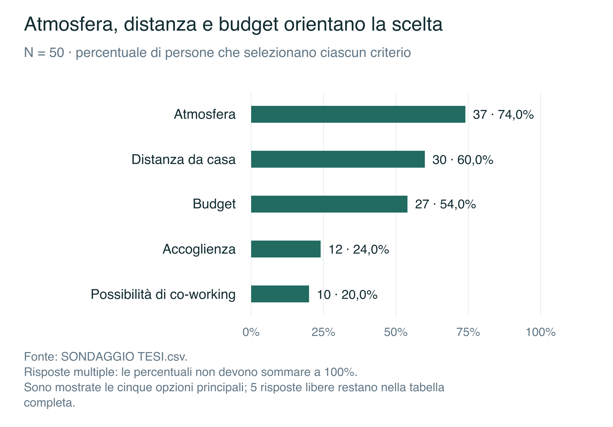

**Didascalia.** Principali criteri selezionati nel primo sondaggio. Atmosfera: 37/50; distanza: 30/50; budget: 27/50.

**Fonte.** Elaborazione dei dati di SONDAGGIO TESI.csv.

Risposte multiple: le percentuali non devono sommare a 100%. Sono mostrate le cinque opzioni principali; 5 risposte libere restano nella tabella completa.

[Figura in SVG](grafici_ricerca/S04.svg) · [Figura in PNG](grafici_ricerca/S04.png)

## Grafico sondaggio S05 — La fiducia cambia secondo le condizioni della domanda

**Collocazione:** 2.1 — Primo questionario. **Natura:** risultato del questionario.

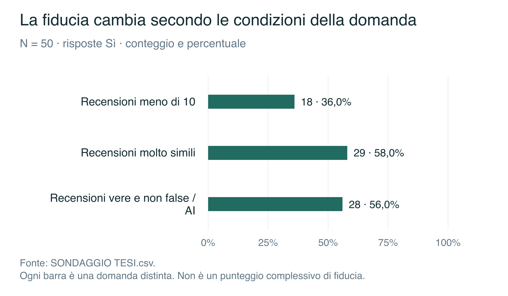

**Didascalia.** Risposte Sì alle tre domande sulla fiducia. Le persone non dichiarano una sfiducia uniforme verso tutte le recensioni.

**Fonte.** Elaborazione dei dati di SONDAGGIO TESI.csv.

Ogni barra è una domanda distinta. Non è un punteggio complessivo di fiducia.

[Figura in SVG](grafici_ricerca/S05.svg) · [Figura in PNG](grafici_ricerca/S05.png)

## Grafico sondaggio S06 — Nelle recensioni si cercano soprattutto servizi e prezzi

**Collocazione:** 2.1 — Primo questionario. **Natura:** risultato del questionario.

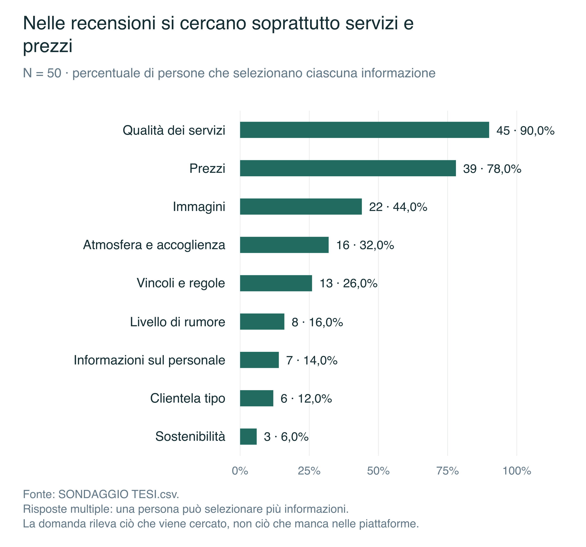

**Didascalia.** Informazioni ricercate: qualità dei servizi 45/50 (90,0%), prezzi 39/50 (78,0%), immagini 22/50 (44,0%).

**Fonte.** Elaborazione dei dati di SONDAGGIO TESI.csv.

Risposte multiple: una persona può selezionare più informazioni. La domanda rileva ciò che viene cercato, non ciò che manca nelle piattaforme.

[Figura in SVG](grafici_ricerca/S06.svg) · [Figura in PNG](grafici_ricerca/S06.png)

## Grafico sondaggio S07 — La proposta di una mappa riceve valutazioni alte

**Collocazione:** 2.1 — Primo questionario. **Natura:** risultato del questionario.

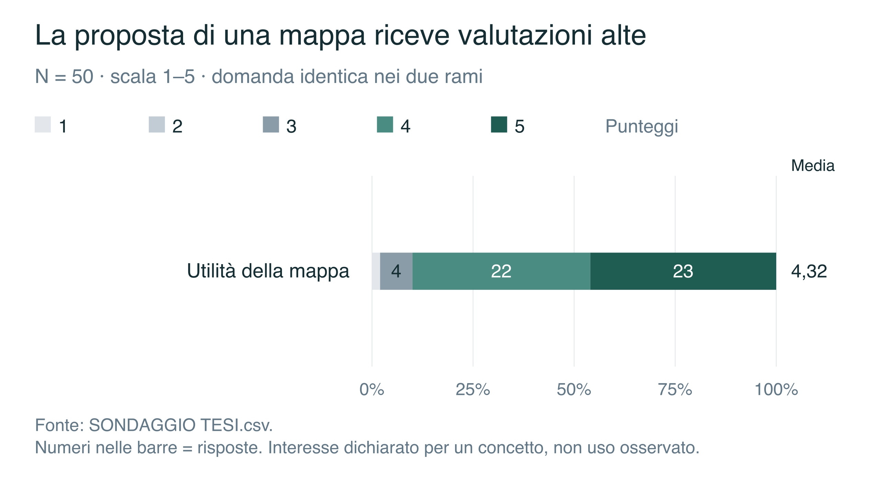

**Didascalia.** Utilità dichiarata di una mappa legata alle attività: 45/50 risposte nei valori 4–5 (90,0%); media 4,32/5.

**Fonte.** Elaborazione dei dati di SONDAGGIO TESI.csv.

Numeri nelle barre = risposte. Interesse dichiarato per un concetto, non uso osservato.

[Figura in SVG](grafici_ricerca/S07.svg) · [Figura in PNG](grafici_ricerca/S07.png)

## Grafico sondaggio S08 — Le esperienze negative hanno frequenze differenti

**Collocazione:** 2.2 — Secondo questionario. **Natura:** risultato del questionario.

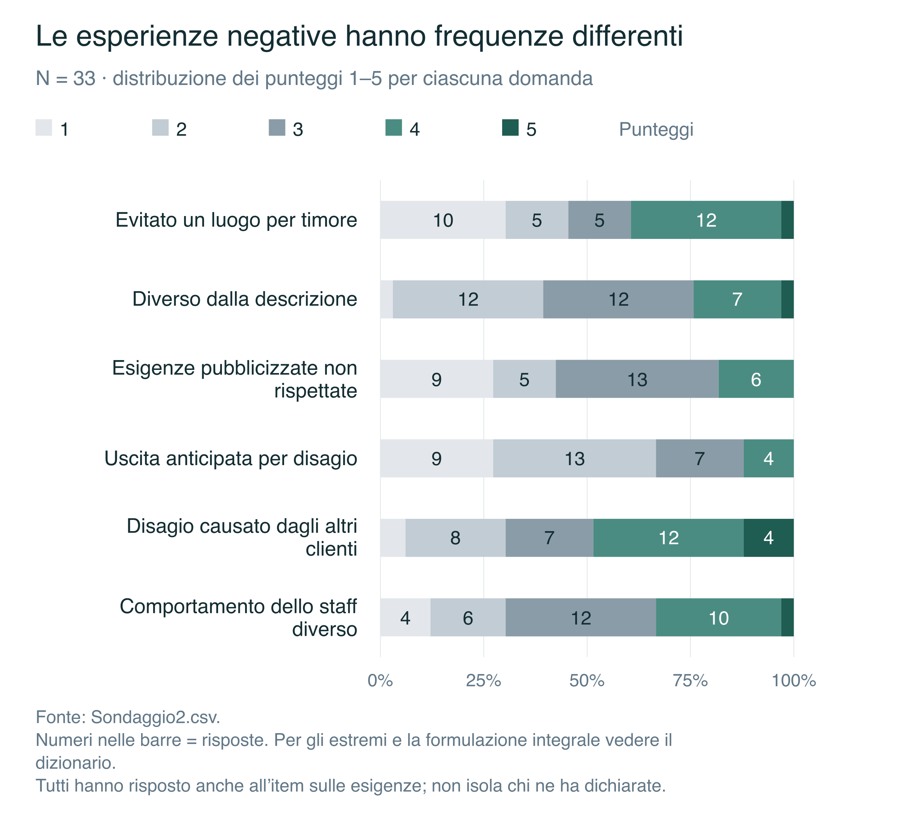

**Didascalia.** Distribuzioni delle esperienze negative nel secondo sondaggio. Valori 4–5: evitamento 13/33, descrizione diversa 8/33, esigenze non rispettate 6/33.

**Fonte.** Elaborazione dei dati di Sondaggio2.csv.

Numeri nelle barre = risposte. Per gli estremi e la formulazione integrale vedere il dizionario. Tutti hanno risposto anche all’item sulle esigenze; non isola chi ne ha dichiarate.

[Figura in SVG](grafici_ricerca/S08.svg) · [Figura in PNG](grafici_ricerca/S08.png)

## Grafico sondaggio S09 — Il racconto privato è più frequente della recensione

**Collocazione:** 2.2 — Secondo questionario. **Natura:** risultato del questionario.

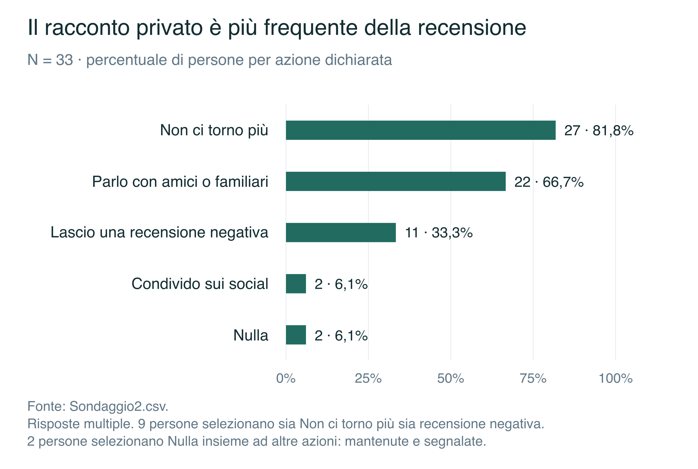

**Didascalia.** Dopo un’esperienza negativa: 27/33 non tornano, 22/33 parlano con amici o familiari, 11/33 lasciano una recensione. Le azioni possono coesistere.

**Fonte.** Elaborazione dei dati di Sondaggio2.csv.

Risposte multiple. 9 persone selezionano sia Non ci torno più sia recensione negativa. 2 persone selezionano Nulla insieme ad altre azioni: mantenute e segnalate.

[Figura in SVG](grafici_ricerca/S09.svg) · [Figura in PNG](grafici_ricerca/S09.png)

## Grafico sondaggio S10 — Sicurezza, accoglienza e chiarezza ricevono i voti maggiori

**Collocazione:** 2.2 — Secondo questionario. **Natura:** risultato del questionario.

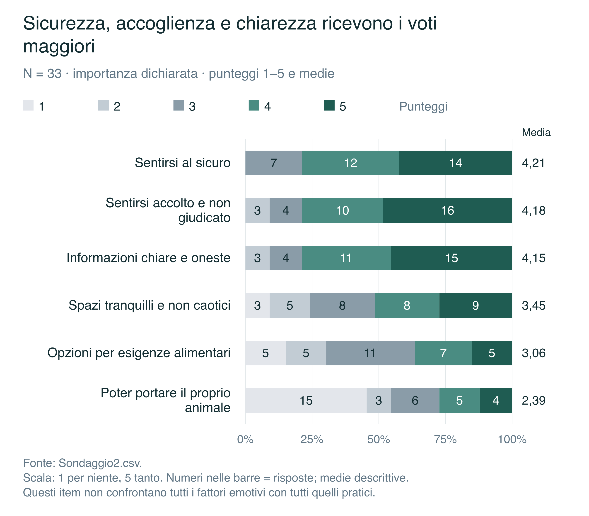

**Didascalia.** Importanza dei fattori indagati: sicurezza media 4,21/5, accoglienza 4,18, informazioni chiare 4,15. Sono riportati tutti i sei criteri.

**Fonte.** Elaborazione dei dati di Sondaggio2.csv.

Scala: 1 per niente, 5 tanto. Numeri nelle barre = risposte; medie descrittive. Questi item non confrontano tutti i fattori emotivi con tutti quelli pratici.

[Figura in SVG](grafici_ricerca/S10.svg) · [Figura in PNG](grafici_ricerca/S10.png)

## Grafico sondaggio S11 — Gli amici sono la compagnia di uscita più indicata

**Collocazione:** 2.2 — Secondo questionario. **Natura:** risultato del questionario.

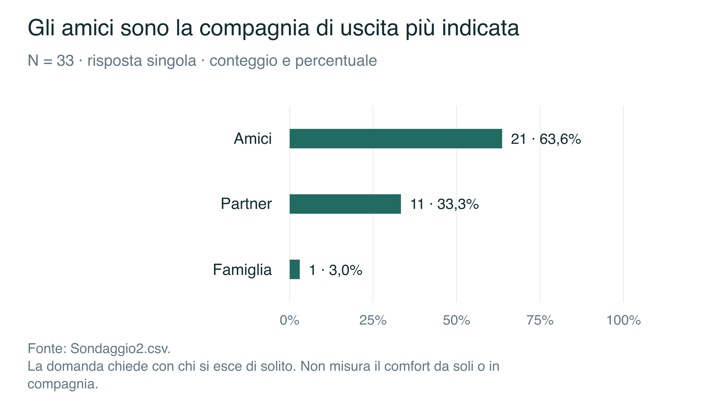

**Didascalia.** Compagnia abituale: amici 21/33 (63,6%), partner 11/33 (33,3%), famiglia 1/33 (3,0%).

**Fonte.** Elaborazione dei dati di Sondaggio2.csv.

La domanda chiede con chi si esce di solito. Non misura il comfort da soli o in compagnia.

[Figura in SVG](grafici_ricerca/S11.svg) · [Figura in PNG](grafici_ricerca/S11.png)

## Grafico sondaggio S12 — Fiducia nella proposta e scelte precedenti sono misure distinte

**Collocazione:** 2.2 — Secondo questionario. **Natura:** risultato del questionario.

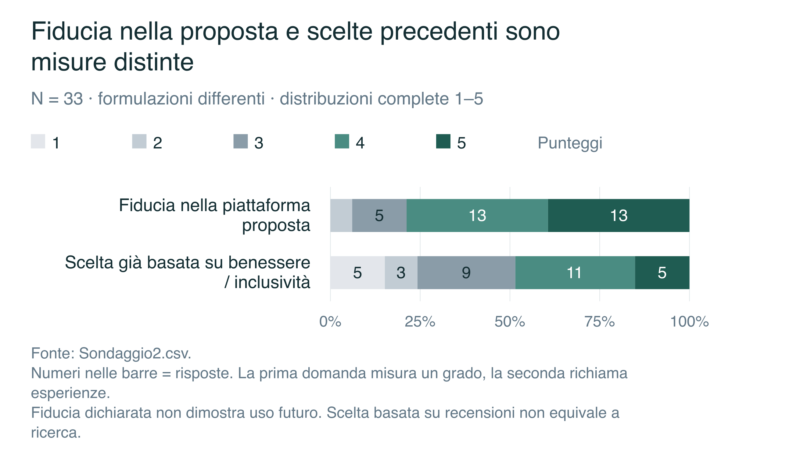

**Didascalia.** Fiducia nella piattaforma proposta: 26/33 valori 4–5 (78,8%), media 4,12/5. Scelta di un luogo basata su recensioni di benessere/inclusività: 16/33 valori 4–5 (48,5%).

**Fonte.** Elaborazione dei dati di Sondaggio2.csv.

Numeri nelle barre = risposte. La prima domanda misura un grado, la seconda richiama esperienze. Fiducia dichiarata non dimostra uso futuro. Scelta basata su recensioni non equivale a ricerca.

[Figura in SVG](grafici_ricerca/S12.svg) · [Figura in PNG](grafici_ricerca/S12.png)

## Grafico sondaggio S13 — Quanto viene percepita una funzione rigida degli spazi

**Collocazione:** 2.1 — Primo questionario. **Natura:** risultato del questionario.

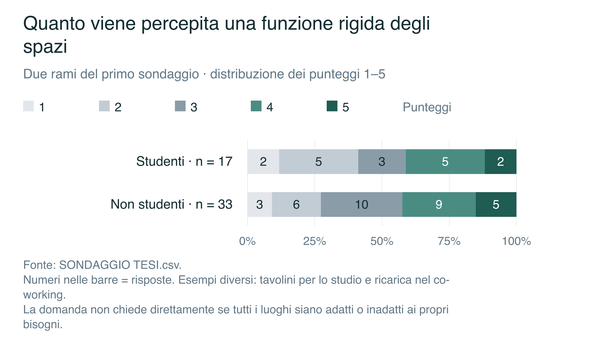

**Didascalia.** Distribuzioni della percezione di spazi progettati per una funzione rigida. Valori 4–5: 7/17 studenti e 14/33 non studenti.

**Fonte.** Elaborazione dei dati di SONDAGGIO TESI.csv.

Numeri nelle barre = risposte. Esempi diversi: tavolini per lo studio e ricarica nel co-working. La domanda non chiede direttamente se tutti i luoghi siano adatti o inadatti ai propri bisogni.

[Figura in SVG](grafici_ricerca/S13.svg) · [Figura in PNG](grafici_ricerca/S13.png)
