# Apparati della proposta progettuale

Le figure documentano la proposta progettuale: architettura, flussi, wireframe e direzioni visive. Non riportano risultati dei test con persone. Il catalogo dimostrativo usa luoghi fittizi di Roma e Milano, mentre il perimetro previsto dell’applicazione comprende l’Italia.

## P01 — Architettura generale proposta

**Collocazione:** 5.1 — Architettura generale. **Natura:** proposta progettuale.

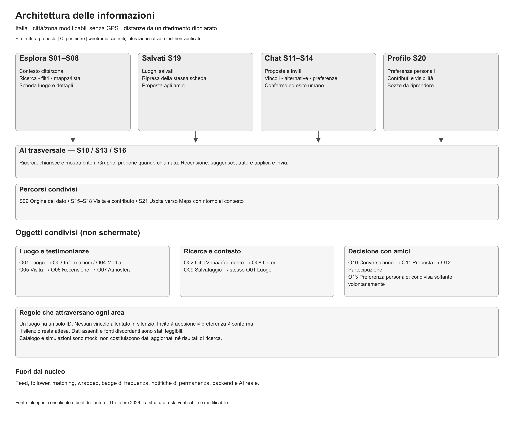

**Didascalia.** Quattro aree di navigazione, oggetti condivisi e assistente trasversale compongono l’architettura proposta. La struttura resta da valutare con le persone.

[Apri la figura a piena risoluzione](../03_architettura/Architettura_generale.png)

## P02 — Scelta individuale

**Collocazione:** 5.3 — Flussi principali. **Natura:** proposta progettuale.

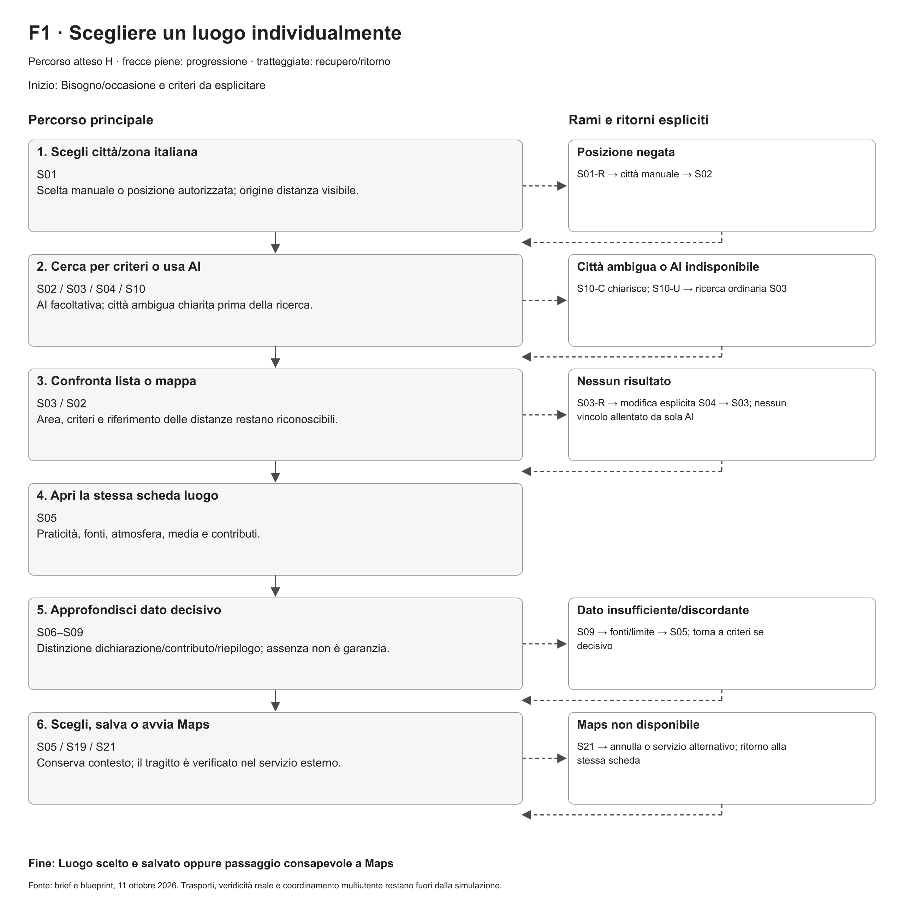

**Didascalia.** Flusso progettato per cercare un luogo individualmente: ricerca manuale, assistente facoltativo e percorsi di recupero. Il diagramma rappresenta il comportamento previsto del prodotto.

[Apri la figura a piena risoluzione](../02_flussi/F1_User_flow.png)

## P03 — Scelta con amici

**Collocazione:** 5.3 — Flussi principali. **Natura:** proposta progettuale.

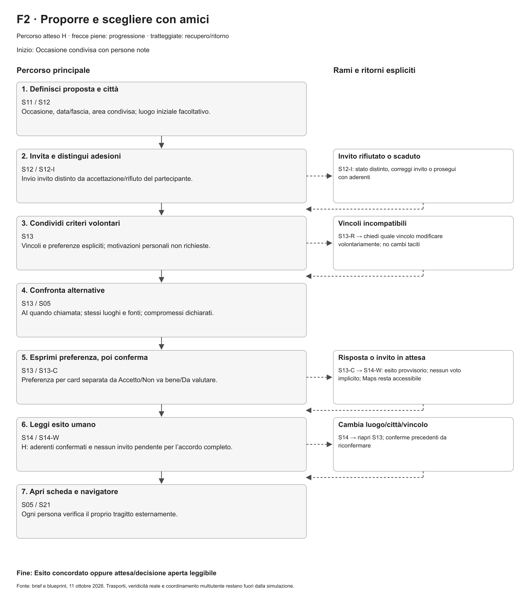

**Didascalia.** Flusso progettato per decidere insieme: invito, adesione, espressione della preferenza e conferma sono passaggi distinti. La coordinazione di un gruppo reale resta da verificare.

[Apri la figura a piena risoluzione](../02_flussi/F2_User_flow.png)

## P04 — Contributo dopo una visita

**Collocazione:** 5.3 — Flussi principali. **Natura:** proposta progettuale.

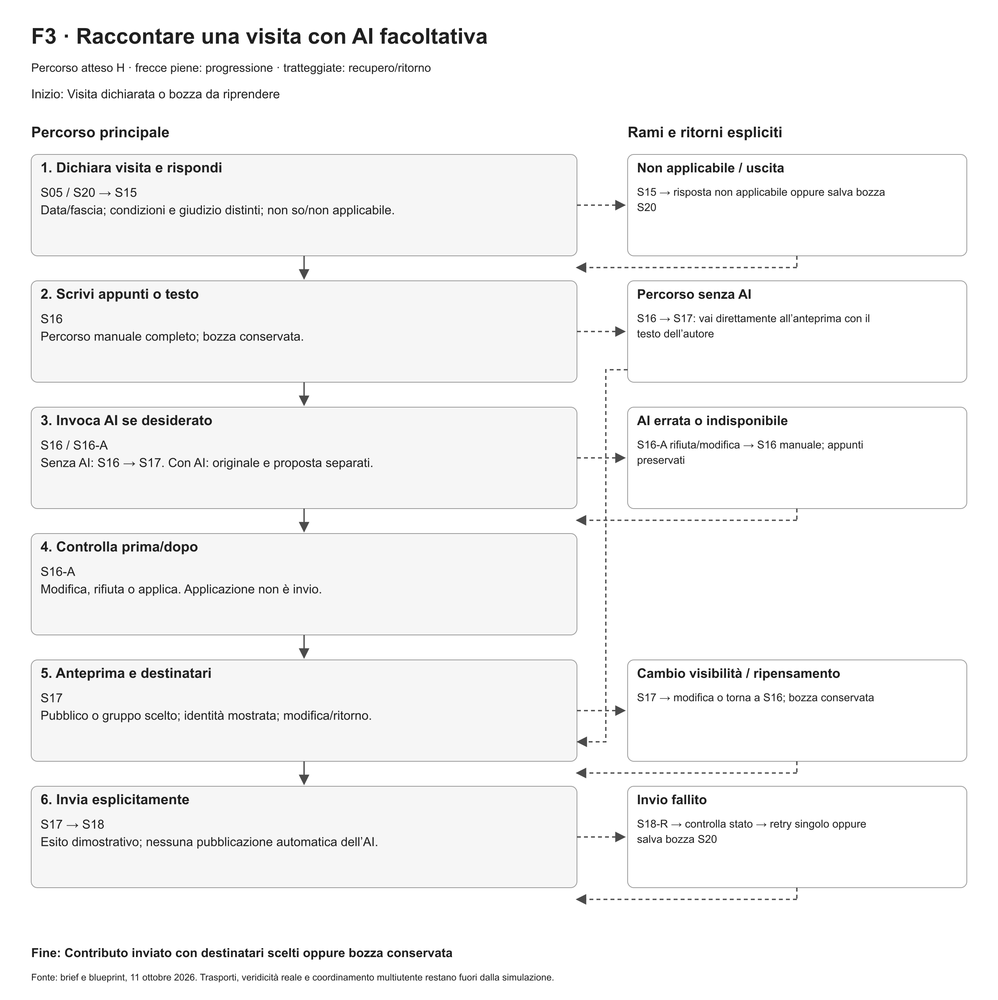

**Didascalia.** Flusso progettato per scrivere una recensione, controllare il suggerimento dell’assistente e inviare il contributo con un’azione esplicita. Nel supporto locale le risposte dell’assistente e l’invio sono simulati.

[Apri la figura a piena risoluzione](../02_flussi/F3_User_flow.png)

## P05a — Schermata S03 — Ricerca

**Collocazione:** 5.4 — Wireframe. **Natura:** proposta progettuale.

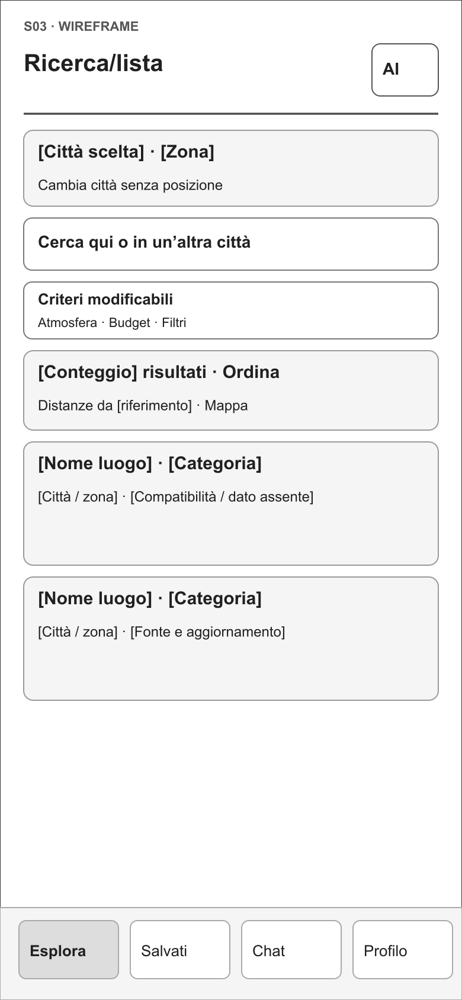

**Didascalia.** Wireframe della ricerca: i componenti definiscono gerarchia e interazione. La figura usa etichette di tipo, senza contenuti specifici di un locale.

[Apri la figura a piena risoluzione](../04_wireframe/png/S03.png)

## P05b — Schermata S05 — Scheda luogo

**Collocazione:** 5.4 — Wireframe. **Natura:** proposta progettuale.

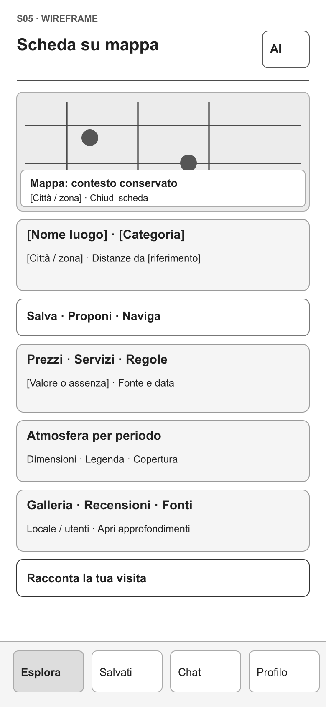

**Didascalia.** La scheda luogo riunisce informazioni, atmosfera, immagini e contributi delle persone. La figura usa etichette di tipo, senza contenuti specifici di un locale.

[Apri la figura a piena risoluzione](../04_wireframe/png/S05.png)

## P06a — Schermata S13 — Proposta di gruppo

**Collocazione:** 5.4 — Wireframe. **Natura:** proposta progettuale.

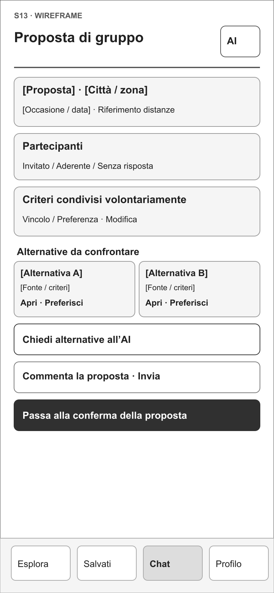

**Didascalia.** La proposta di gruppo riunisce criteri condivisi, alternative e accesso facoltativo all’assistente. La figura usa etichette strutturali; messaggi e risposte dei partecipanti non sono rappresentati.

[Apri la figura a piena risoluzione](../04_wireframe/png/S13.png)

## P06b — Schermata S14-W — Decisione in attesa

**Collocazione:** 5.4 — Wireframe. **Natura:** proposta progettuale.

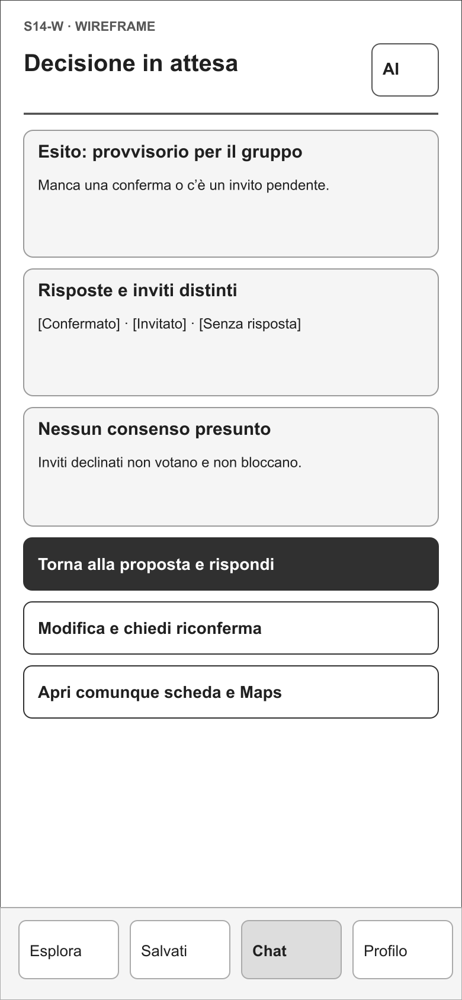

**Didascalia.** Lo stato di attesa rende visibile che la raccolta delle preferenze non coincide con la conferma finale del gruppo.

[Apri la figura a piena risoluzione](../04_wireframe/png/S14-W.png)

## P07a — Schermata S16-A — Supporto alla recensione

**Collocazione:** 5.4 — Wireframe. **Natura:** proposta progettuale.

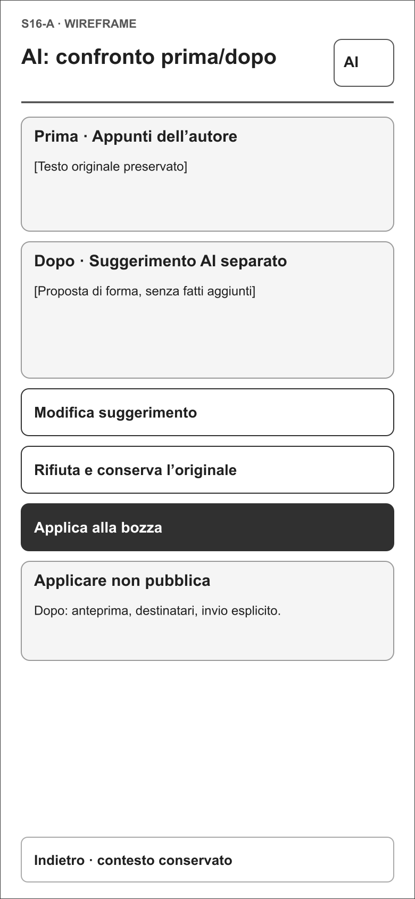

**Didascalia.** Il supporto alla recensione parte dal contributo della persona e presenta un testo modificabile. La persona mantiene il controllo del contenuto.

[Apri la figura a piena risoluzione](../04_wireframe/png/S16-A.png)

## P07b — Schermata S17 — Controllo prima dell’invio

**Collocazione:** 5.4 — Wireframe. **Natura:** proposta progettuale.

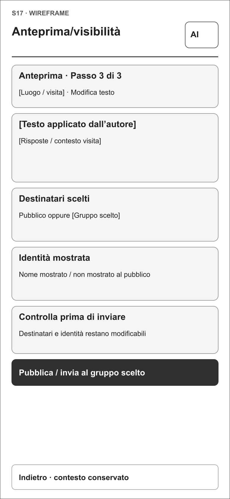

**Didascalia.** Il controllo finale precede l’invio esplicito. Il wireframe documenta l’interazione proposta, ancora da verificare durante i test.

[Apri la figura a piena risoluzione](../04_wireframe/png/S17.png)

## P08a — Style tile A

**Collocazione:** 5.5 — Direzione visiva. **Natura:** proposta progettuale.

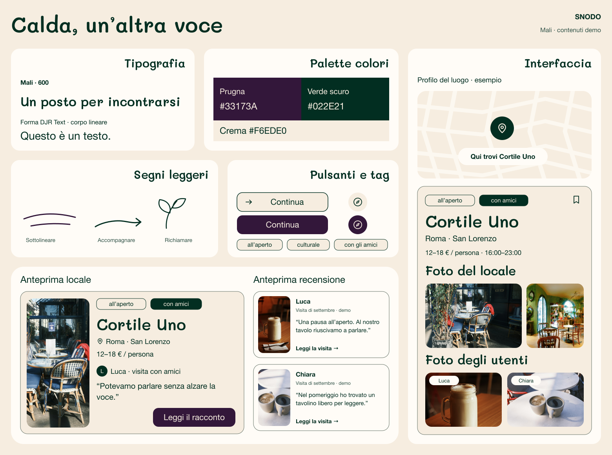

**Didascalia.** Direzione A, revisione con Mali SemiBold 600: crema #F6EDE0, verde scuro #022E21 e prugna #33173A. Titoli handwritten senza grazie, corpo lineare, card con preview della recensione e due gallerie. È la direzione alternativa alla Pop, che rimane lo stile principale; il confronto con gli utenti deve ancora avvenire.

[Apri la figura a piena risoluzione](../05_style_tiles/Style_tile_A.png)

## P08b — Style tile B

**Collocazione:** 5.5 — Direzione visiva. **Natura:** proposta progettuale.

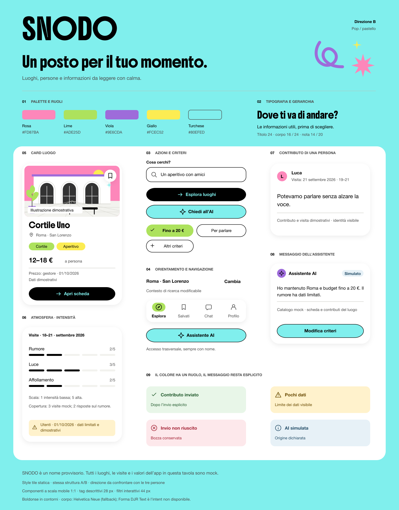

**Didascalia.** Direzione B, revisione 0.3, derivata dalla proposta visiva dello studente dell’11 ottobre 2026: palette pop #FD87BA, #ADE25D, #9E6CDA, #FCEC52, #80EFED, titoli Boldonse e corpo previsto Forma DJR Text, sostituito da Helvetica Neue nell’anteprima. Le superfici bianche e gli accenti circoscritti distinguono contenuto, azioni e selezioni. Contenuti e compiti restano confrontabili con A; la scelta degli utenti è ancora aperta e i dati mostrati sono dimostrativi.

[Apri la figura a piena risoluzione](../05_style_tiles/Style_tile_B.png)

## P09 — Stati dei componenti

**Collocazione:** 5.5 — Design system. **Natura:** proposta progettuale.

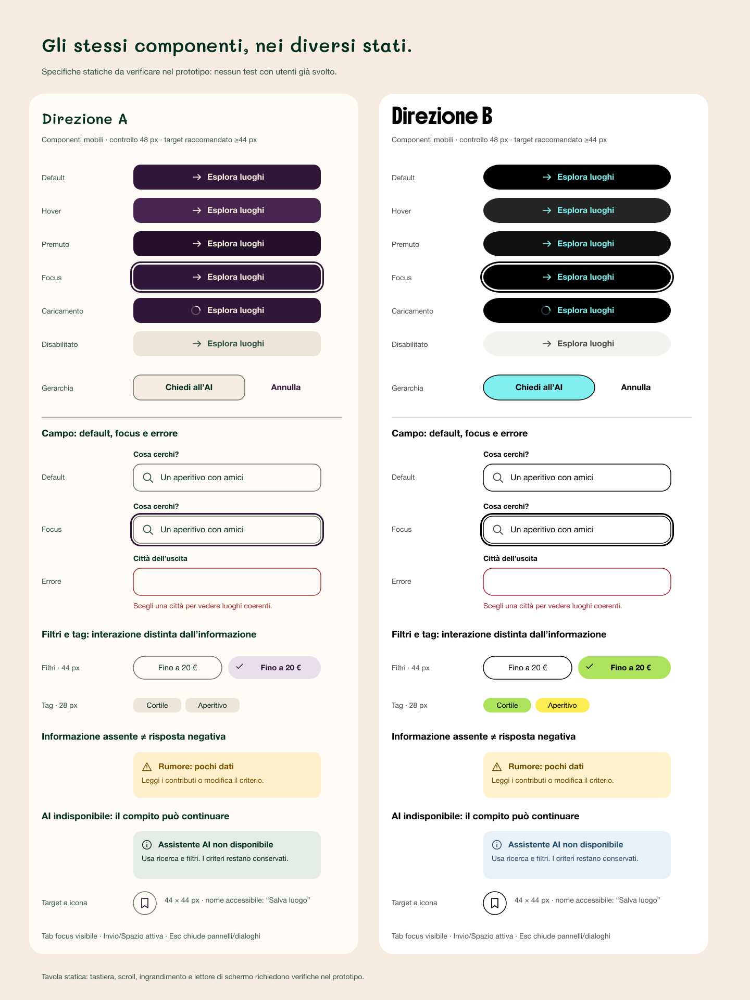

**Didascalia.** Stati dei componenti, revisione 0.3: pulsanti, campi, selezioni, focus e messaggi di recupero nelle due direzioni provvisorie. I campioni statici documentano le specifiche visive proposte; i comportamenti vanno verificati nel file navigabile. La tavola non costituisce una verifica complessiva di accessibilità.

[Apri la figura a piena risoluzione](../06_design_system/Stati_e_controlli.png)

## Tavole complete per l’appendice progettuale

Le tavole riuniscono i wireframe del progetto. Le schermate selezionate nelle figure precedenti mostrano in maggiore dettaglio i componenti e le gerarchie.

[Tavola dei wireframe 1](../04_wireframe/Tavola_wireframe_1.png)

[Tavola dei wireframe 2](../04_wireframe/Tavola_wireframe_2.png)

[Tavola dei wireframe 3](../04_wireframe/Tavola_wireframe_3.png)

[Tavola dei wireframe 4](../04_wireframe/Tavola_wireframe_4.png)

[Tavola dei wireframe 5](../04_wireframe/Tavola_wireframe_5.png)
