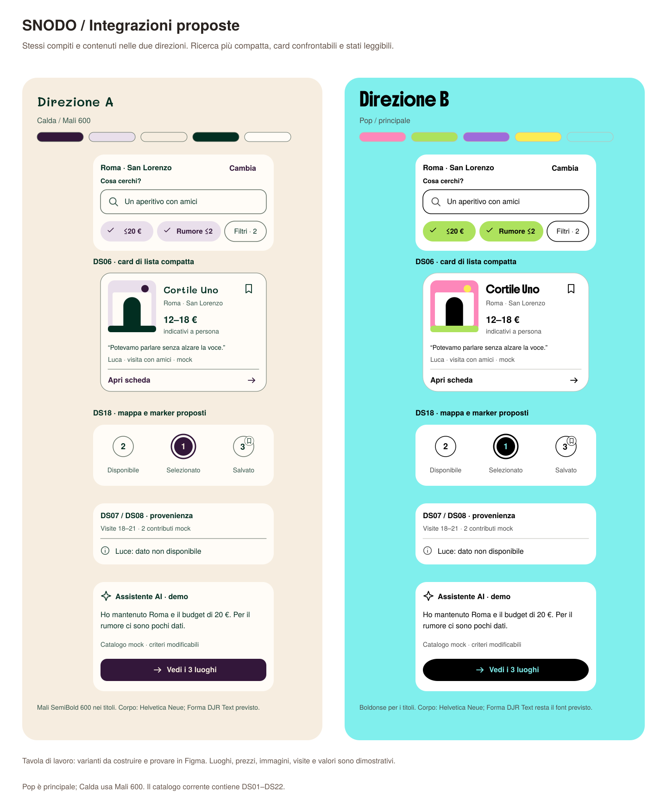
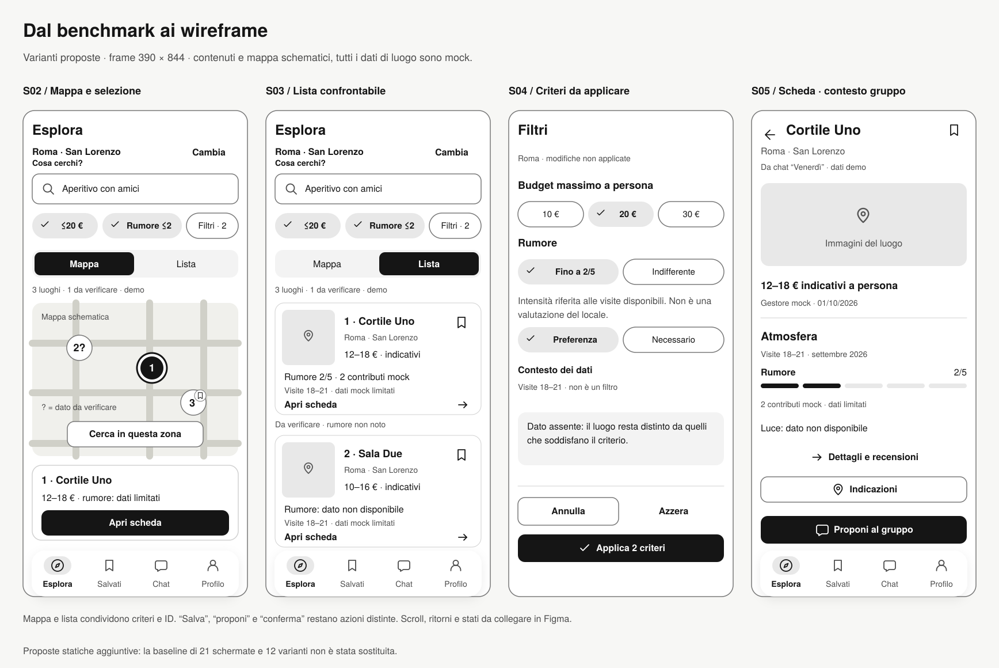

# Benchmark UX/UI e integrazioni per SNODO

**Aggiornamento di implementazione, 11 ottobre 2026.** La revisione v0.6 integra nel supporto HTML card con recensione, filtri in bozza, mappa/lista coerenti, distinzione necessario/preferenza e CTA contestuale. DS-MAP è ora DS18; DS20/DS21/DS22 sono aggiunti al catalogo. [Regole e stato](../06_design_system/Esplorazione_e_recensioni.md). Le tavole qui sotto documentano la proposta precedente; le anteprime aggiornate sono nel [design system](../06_design_system/index.html#esplorazione). Figma, pan geografico e ricerca reale nell’area restano da costruire.

Questo è **materiale di lavoro**, destinato a orientare la prossima costruzione in Figma. Non è un nuovo capitolo candidato alla tesi, non modifica le specifiche attuali e non descrive interventi già implementati. L’analisi parte dalle 21 schermate S01–S21 e dalla base v0.3 con componenti DS01–DS17; **DS-MAP è una nuova proposta**, con etichetta temporanea: assegnare il numero definitivo quando viene adottata, senza occupare la numerazione delle integrazioni già in corso.

Il confronto riguarda TheFork, Google Maps, Tripadvisor e Airbnb Experiences. Le fonti ufficiali documentano funzioni, contenuti e regole; non dimostrano una maggiore usabilità o conversione. Le ricerche desktop pubbliche dei quattro prodotti sono state osservate l’11 ottobre 2026: Roma per TheFork e Tripadvisor, luoghi a Roma per Google Maps, esperienze a Roma per Airbnb. Sono state esaminate gerarchia, card, filtri, azioni e rapporto con la mappa; le funzionalità ulteriori sono descritte dalle fonti ufficiali citate. Non è stata eseguita un'analisi sistematica delle app native: versione, account, mercato e dispositivo possono cambiare l'interfaccia. Le proposte per SNODO sono inferenze progettuali, da verificare con compiti concreti.

Le integrazioni proposte riguardano: card compatta nella lista e approfondimento nella scheda; due filtri rapidi e accesso a tutti i filtri con bozza/applicazione/azzeramento; città, criteri e ID luogo condivisi fra mappa e lista; una specifica esplicita per mappa e marker; una CTA primaria coerente con il contesto in S05; atmosfera con periodo e copertura, senza stelle; distinzione fra salvataggio, proposta, preferenza, conferma e controllo dell'autore nella recensione.

## 1. Che cosa ricaviamo dai quattro prodotti

### TheFork

TheFork organizza la scoperta intorno alla scelta di un ristorante e alla prenotazione. La pagina ufficiale dell'app documenta filtri, selezioni e conferma immediata; nella ricerca desktop Roma osservata, barra di ricerca, filtri rapidi, card e mappa accompagnano il confronto. Le card affiancano fotografia, valutazione e conteggio, prezzo medio, sconti e disponibilità oraria. Il pattern utile è una struttura ripetibile che permette di confrontare opzioni prima di approfondirle. [App TheFork](https://mobile.thefork.it/), [ricerca Roma](https://www.thefork.com/restaurants/rome-c461789).

Le condizioni collegano le recensioni a prenotazione/invito e visita effettuata. La valutazione distingue cibo, servizio e atmosfera con pesi del 50%, 25% e 25%; rumore e attesa sono criteri aggiuntivi. Questo suggerisce di separare provenienza e dimensioni, senza importare il punteggio complessivo. [Note legali, §2.5 e sezione E](https://www.thefork.it/legal).

Feed e liste introducono raccomandazioni di amici e creator, non una decisione condivisa. Per SNODO è utile il collegamento dalla lista allo stesso luogo, non la costruzione di una nuova rete sociale. Prenotazioni, sconti, fedeltà e orari prenotabili non entrano nel perimetro attuale. [Annuncio ufficiale Feed, 21 agosto 2025](https://www.theforkmanager.com/en/blog/introducing-thefork-feed-helping-diners-discover-more-of-their-new-favourite-restaurants-through-friends-and-top-creators).

### Google Maps

Google Maps documenta la ricerca per nome, indirizzo e categoria e l'apertura dei dettagli selezionando un luogo. Nella guida Android il filtro segue una sequenza esplicita: aprire gli altri filtri, selezionare e applicare. È un riferimento per mantenere comprensibile il passaggio fra richiesta e risultati; non una prova che gli stessi controlli siano adatti a SNODO. [Ricerca e filtri Android](https://support.google.com/maps/answer/3092445?co=GENIE.Platform%3DAndroid&hl=it).

La guida all'accessibilità desktop descrive lettori di schermo, tastiera e una lista numerata dei luoghi nell'area evidenziata. Il principio trasferibile è l'accesso equivalente ai luoghi, senza imporre l'uso visivo della mappa. [Accessibilità in Google Maps](https://support.google.com/maps/answer/6396990?hl=en).

Google distingue affluenza abituale, basata sugli ultimi mesi, e dati in tempo reale. Li mostra quando dispone di dati sufficienti, anonimi e aggregati provenienti da utenti che hanno attivato la cronologia delle posizioni. SNODO non dispone di questa infrastruttura: il grafico di atmosfera non può presentarsi come affollamento attuale né come previsione certa. Conviene trasferire la distinzione temporale e la gestione dei dati assenti, evitando GPS obbligatorio, tempi di percorrenza o valori ambientali inventati. [Orari di punta e dati sulle visite](https://support.google.com/business/answer/6263531?hl=it).

### Tripadvisor

Tripadvisor affianca ricerca, recensioni e pianificazione. Nella pagina desktop Roma osservata sono presenti mappa, filtri per prezzo/valutazione/tipologia e card con valutazione, conteggio, fascia di prezzo, apertura o chiusura ed estratti. Sono visibili anche etichette sponsorizzate e la spiegazione dell'ordinamento Featured: per SNODO interessa rendere leggibili i criteri, non riprodurre un ranking commerciale. [Ristoranti Roma](https://www.tripadvisor.com/Restaurants-g187791-Rome_Lazio.html).

La descrizione dello sviluppatore include luoghi salvati, mappa e collaborazione nei Viaggi. Il salvataggio sostiene una scelta successiva, ma la collaborazione non equivale a una conferma del gruppo. [Descrizione ufficiale dell'app](https://apps.apple.com/it/app/tripadvisor-prenota-viaggi/id284876795).

Tripadvisor richiede una dichiarazione di esperienza personale, senza obbligo di ricevuta, e descrive valutazione dei contenuti prima della pubblicazione e segnalazioni successive. Invio e pubblicazione sono quindi stati distinti. [Integrità dei contenuti](https://www.tripadvisor.com/Trust-lRbpvspYMg9E.html).

Le linee guida vietano recensioni con testo o immagini generati dall'AI; non è stata verificata un'eccezione per l'assistenza grammaticale. L'aiuto editoriale proposto da SNODO richiede una propria regola e motivazione: non può essere presentato come pratica ammessa da Tripadvisor. Non trasferiamo booking, premi o un punteggio come garanzia di comfort. [Content & Community Guidelines](https://www.tripadvisor.com/Trust-llmsjBtituuk.html).

### Airbnb Experiences

Airbnb permette di cercare servizi ed esperienze per città e date; Nearby usa la posizione precisa, con permessi gestibili. Per SNODO il riferimento è la scelta geografica esplicita, mantenendo la ricerca manuale anche senza posizione. Le date delle esperienze sono legate alla disponibilità di attività prenotabili: non diventano automaticamente un calendario di prenotazione di luoghi. [Ricerca di servizi ed esperienze](https://www.airbnb.com/help/article/1584).

Le wishlist consentono salvataggio, note e voti dei collaboratori. Questi sono strumenti di confronto, non conferme di partecipazione; la guida distingue anche condivisione collaborativa e sola lettura. [Wishlist e collaborazione](https://www.airbnb.com/help/article/1236).

Le informazioni di accessibilità descrivono caratteristiche concrete, fra cui accesso senza gradini e spazio tranquillo per ritirarsi; quando mancano dettagli la guida invita a contattare l'host. SNODO può adottare informazioni circostanziate con fonte, non un badge universale di sicurezza o inclusività. [Caratteristiche di accessibilità](https://www.airbnb.com/help/article/3138).

Gli standard degli annunci chiedono fotografie, titoli e descrizioni che chiariscano cosa aspettarsi. Il principio trasferibile è la coerenza fra immagine, titolo e informazione. Verifiche degli host, itinerari, prenotazioni e standard Airbnb non sono capacità di SNODO; le illustrazioni della demo rimangono dichiarate come tali. [Standard di servizi ed esperienze](https://www.airbnb.com/help/article/1451).

### Lettura UI delle pagine osservate

| Prodotto | Gerarchia visiva osservata | Integrazione proposta per SNODO |
|---|---|---|
| TheFork | Card orizzontale: fotografia, identità, prezzo e punteggio; offerte e orari occupano molto spazio operativo. Filtri a pillola, superfici chiare e verde per le azioni. | Card compatta con campi allineati; atmosfera e copertura prendono il posto delle disponibilità commerciali. |
| Google Maps | Mappa dominante, lista laterale densa, immagini secondarie e filtri in alto. Marker, elenco e pannello sostengono la stessa ricerca. | Coerenza fra viste; indicatore selezionato chiaro; lista pienamente utilizzabile quando la mappa manca. |
| Tripadvisor | Titoli grandi, foto, valutazioni e conteggi riconoscibili; bianco e verde strutturano azioni e navigazione. Sponsorizzazioni e ordinamento sono visibili. | Separare reputazione, informazioni pratiche e atmosfera. Dichiarare il motivo dell’ordinamento senza trasformarlo in un punteggio di comfort. |
| Airbnb Experiences | Fotografie ampie, superfici chiare, nomi in evidenza, prezzo e valutazione subordinati. Salvataggio sovrapposto al media e ricerca compatta in alto. | Foto con proporzione coerente e salvataggio distinto dall’apertura; conservare spazio per il limite dei dati, più importante di un effetto decorativo. |

Questa lettura riguarda le pagine desktop collegate sopra. Non ricava misure, token, componenti interni o prestazioni delle app. La proposta adotta una struttura comprensibile e mantiene l’identità visiva di SNODO.

## 2. Proposta di integrazione per schermate e componenti

### Ricerca: meno contenuti nella card, più continuità fra viste

**S02/S03 — contesto prima dei risultati.** Mostrare città e zona, se selezionata, con un controllo di modifica leggibile. La stessa ricerca conserva testo, criteri applicati, ID luogo e selezione. Il cambio mappa/lista cambia la rappresentazione, non il contenuto della ricerca. Un cambio città richiesto dall'utente aggiorna il contesto e segnala i criteri che non sono più applicabili; non conserva distanze prive di riferimento e non mescola città senza dichiararlo. L'assistente legge e propone modifiche a questo stesso contesto.

**DS06 — card compatta di confronto.** In lista: una media con proporzione costante, nome, città/zona, prezzo indicativo, massimo due caratteristiche utili e un limite decisivo quando presente. “Apri scheda” e “Salva” devono essere controlli distinti. Niente anteprima di recensione nella Home/ricerca: il contributo si approfondisce in S05/S08. Gli stati proposti sono standard, selezionata, salvata, prezzo assente e pochi dati. Non allungare tutte le card per ripetere spiegazioni generali; non nascondere però “rumore: dati limitati” se determina la decisione. Il conteggio si riferisce alla dimensione, non genericamente a tutte le recensioni.

**S04 — due filtri rapidi e tutti i filtri.** Nella proposta si espongono Budget e Rumore, accanto a “Filtri” con il numero dei criteri applicati. Affollamento e gli altri criteri restano nel pannello completo. La priorità dei due filtri è un’ipotesi da verificare; i valori attivi sono espliciti, per esempio “≤20 €” e “Rumore ≤2”. Ogni controllo apre una modifica circoscritta con lo stesso significato del campo in “Tutti i filtri”. La selezione avviene in una bozza temporanea: “Applica” sostituisce i criteri correnti; “Annulla” o chiusura lascia invariati i risultati; “Azzera filtri” modifica la bozza e richiede applicazione. L'azzeramento non cambia città o testo di ricerca. Dopo l'applicazione, mostrare criteri attivi rimovibili e risultato vuoto con recupero esplicito. Dati non disponibili non equivalgono alla fascia bassa o all'assenza di rumore. La proposta raggruppa separatamente i luoghi “Da verificare” quando manca il dato richiesto. Non sono presentati come compatibili; il limite resta vicino al valore. Se il rumore è un vincolo inderogabile, questi luoghi non entrano nelle proposte compatibili dell’AI o del gruppo. S04 rende il significato esplicito con “Preferenza” e “Necessario” per il rumore. Le tavole mostrano la modalità Preferenza; il marker con “?” e il gruppo “Da verificare” segnalano il dato assente nelle due viste. “Contesto dei dati: visite 18–21” è un riepilogo non modificabile nella proposta, non un terzo filtro: il conteggio di due criteri riguarda budget e rumore. Se si introduce una fascia oraria che restringe i risultati, va aggiunta al conteggio e allo stato condiviso. Testare queste regole prima di adottarle.

### S05: approfondimento orientato al compito

La sequenza proposta per il contenuto è: identità e posizione del luogo; galleria sintetica; prezzo e informazioni pratiche; atmosfera con limiti; dettagli e testimonianze; approfondimento delle fonti. L’azione primaria rimane disponibile in basso in un pannello fisso, separato dal contenuto che scorre: nella tavola S05 è “Proponi al gruppo”, mentre “Indicazioni” è secondaria. La scheda ridotta sulla mappa presenta identità e apertura del dettaglio. Gli stati intermedi ed espansi aggiungono contenuti senza creare un oggetto diverso o perdere il luogo selezionato.

**Una CTA primaria per contesto**, da provare: nell'esplorazione individuale “Salva il luogo” se non è già salvato; da una proposta di gruppo “Proponi al gruppo”; nel ritorno a un luogo già scelto “Indicazioni”, con passaggio esterno dichiarato. Le altre azioni restano disponibili come secondarie. “Proponi” non diventa “Conferma”: la conferma appartiene alla decisione di gruppo. Le CTA non promettono prenotazione, disponibilità né percorso ottimizzato.

**DS07/08 — atmosfera, periodo e copertura.** Separare Rumore, Luce e Affollamento con scale di intensità 1–5 e descrizione dei due estremi; non usare stelle, cuori o un unico punteggio di benessere. Accanto ai valori: fascia oraria, periodo dei contributi, copertura per dimensione e origine. Il dettaglio spiega come sono stati ottenuti: nel prototipo sono mock, non medie dei questionari né misure ambientali. “Nessun dato” non riempie una barra. “Pochi dati” mantiene il limite vicino al valore; dati vecchi o discordanti hanno uno stato distinto. Le condizioni riportate non diventano una promessa per la prossima visita. Il metodo reale di aggregazione è ancora una decisione da sviluppare.

**DS09/17 — testimonianze e media.** Mostrare identità visibile, visita dichiarata e contesto del contributo. Tenere distinta la voce di una persona dal riepilogo dell'assistente. Per le immagini, distinguere fotografia del gestore, fotografia di un utente e illustrazione dimostrativa; fonte e didascalia restano disponibili nel viewer. Informazioni di accessibilità, quando previste, sono caratteristiche specifiche con provenienza e limite: non un badge che certifica il luogo.

### Gruppo e recensione: azioni che non si confondono

**S11–S14 / DS12.** Conservare quattro significati: “Salva” riguarda la raccolta personale; “Proponi” porta un'alternativa nel gruppo; “Preferisco” esprime una preferenza; “Confermo” è una risposta alla proposta corrente. La UI deve rendere leggibili invitati, aderenti, preferenze e conferme, senza sommarli in un solo contatore. Il silenzio non vale come consenso. Un cambiamento di luogo o vincolo importante riapre le conferme secondo la regola esplicita del blueprint. L'AI confronta criteri e limiti, non attribuisce risposte agli amici e non dichiara raggiunto un accordo.

**S15–S17 / DS10/13.** S15 raccoglie visita dichiarata e condizioni, con opzione non applicabile o dato non noto. S16 mantiene la scrittura manuale e offre un ingresso esplicito all'aiuto AI. Originale e suggerimento sono due contenuti separati: l'originale resta recuperabile; “Applica”, “Modifica” e “Rifiuta” non hanno lo stesso effetto. Un suggerimento che aggiunge fatti non presenti è un errore da correggere, non un miglioramento stilistico. S17 mostra testo effettivo, identità e visibilità prima dell'invio. Uscita ed errore conservano la bozza. L'esito della demo è locale e simulato: non certifica pubblicazione né moderazione. La regola editoriale di SNODO va dichiarata e testata; non viene ricavata per analogia dalle policy degli altri prodotti.

## 3. DS-MAP — Mappa, marker e accesso equivalente alla lista

**Stato: componente proposto, non presente nella base v0.3 esaminata.** DS-MAP è un nome di lavoro, non un nuovo ID numerico del catalogo. Compone DS02 ricerca, DS03 criteri, DS05 contesto, DS06 card, DS11 pannello e DS15 recupero. Sostiene la responsabilità IA C05 e il collegamento con C06; non sostituisce questi ID né crea nuove schermate. Prima di adottarlo occorre aggiornare la corrispondenza IA/DS e le varianti Figma, senza dedurre corrispondenze numeriche.

| Aspetto | Specifica proposta | Criterio di verifica |
|---|---|---|
| Oggetto condiviso | Marker, riga/card e scheda puntano allo stesso ID luogo. Un indice visuale può collegare marker e lista, ma non sostituisce l'ID. | Selezionare lo stesso luogo dalle due viste apre identici nome, prezzo, fonti e limiti. |
| Marker default | Forma riconoscibile, indice o label breve; nome completo disponibile come nome accessibile nell'implementazione. Target raccomandato 44 × 44, anche se il disegno è più piccolo. | Si distingue il luogo senza dipendere dal colore e si attiva senza scegliere quello vicino. |
| Marker selezionato | Sagoma/contorno e label rendono esplicita la selezione; stato annunciabile nell'implementazione. Può aggiungersi enfasi cromatica. | È possibile indicare quale luogo è selezionato anche in scala di grigi. |
| Marker salvato | Segno di salvataggio distinto dalla selezione. Sono possibili selezionato e salvato contemporaneamente. | Salvare non cambia la selezione; aprire un luogo non lo salva. |
| Dato mancante | Il marker aggiunge “?” con legenda “dato da verificare”; la lista raggruppa lo stesso ID sotto “Da verificare”. Questo stato è indipendente da selezione e salvataggio. | Un luogo senza dato sul rumore non appare compatibile con il criterio. In modalità Necessario è escluso dalle proposte compatibili, ma resta identificabile nella raccolta di luoghi da verificare. |
| Sincronizzazione | Selezionare un marker evidenzia la card corrispondente; selezionare la card evidenzia il marker. Cambio vista e ritorno da S05 conservano il contesto. | Nessuna selezione di un altro ID né perdita di criteri al ritorno. |
| Cerca qui | Dopo uno spostamento dell'area, “Cerca qui” propone un aggiornamento esplicito. Lo spostamento da solo non cambia i risultati; l'azione applica la nuova area e mantiene gli altri criteri. | Prima dell'azione i risultati restano riconoscibili come riferiti all'area precedente; dopo si rende leggibile l'area applicata. |
| Area e città | L'area visibile e l'area di ricerca sono distinguibili. Per cambiare città si usa il controllo del contesto; il pan non la sostituisce di nascosto. | Lo scenario Roma → Milano non produce un elenco ambiguo o conserva una falsa distanza. |
| Caricamento/errore | Caricamento, mappa non disponibile e nessun risultato sono stati diversi. Errore cartografico offre “Mostra lista” e conserva città/criteri. | Il compito prosegue dalla lista senza ricominciare la ricerca. |
| Tastiera e alternativa | Lista raggiungibile con controllo nominato; ordine logico; selezione e apertura con tastiera. Eventuale mappa interattiva non blocca il focus. | Lo stesso luogo può essere cercato, confrontato e aperto senza drag e senza interagire visivamente con la mappa. |
| Posizione/distanze | Ricerca manuale sempre disponibile. GPS solo facoltativo, se realmente implementato e autorizzato. Distanze richiedono riferimento esplicito e calcolo reale. | Posizione negata o assente non blocca il compito; nessun chilometro o tempo inventato. |
| Demo cartografica | Se si usa un disegno schematico, dichiararlo. Marker e posizioni sono dimostrativi; “Cerca qui” può essere solo una transizione simulata dichiarata. | Nessuna didascalia presenta coordinate, cartografia, percorso o geolocalizzazione reali non disponibili. |

Le tavole SVG mostrano soltanto forme e stati. Non implementano tastiera, focus, lettore di schermo o cartografia. Le interazioni Figma permettono di verificare comprensione e continuità del flusso; una dichiarazione di accessibilità tecnica richiede verifiche su un'implementazione effettiva.

### Proprietà e varianti da aggiungere ai componenti esistenti

Le seguenti proprietà sono una specifica di lavoro da portare in Figma. Non sono già varianti native o modifiche ai JSON del DS corrente.

| Componente | Proprietà proposte | Regola di composizione |
|---|---|---|
| DS02 — ricerca | `query`, `city`, `area`, `loading`, `error`, `manualLocation` | Label persistente; città modificabile; ricerca manuale disponibile quando manca la posizione. |
| DS03 — filtro | `criterion`, `value`, `importance=preference/required`, `applied`, `draft`, `available` | Tag descrittivo e filtro sono componenti diversi. Un criterio modificato nella bozza non assume lo stato applicato. Rimozione singola esplicita e annullabile. |
| DS06 — luogo | `layout=compact/featured/panel`, `selected`, `saved`, `priceKnown`, `dataCoverage` | Stesso ID e significato dei campi. In lista si confronta, in scheda si approfondisce; salvataggio con target 44 separato dall’apertura. |
| DS07/08 — dati | `dimension`, `period`, `timeBand`, `source`, `coverage=present/limited/missing/stale/conflicting` | Conteggio della dimensione accanto al valore. Stato assente espresso a parole; grafico e limiti non dipendono solo dal colore. |
| DS10 — AI | `context=individual/group/review`, `status=simulated/loading/unavailable`, `criteria`, `source` | Identità AI sempre leggibile; proposta di modifica separata dai criteri applicati. Nessuna conferma, pubblicazione o informazione inventata. |
| DS11 — pannello | `size=reduced/intermediate/expanded`, `returnView`, `selectedPlace`, `scrollPosition` | Controlli nominati oltre al drag; ritorno alla stessa ricerca e selezione. La CTA segue il contesto del compito. |
| DS12 — gruppo | `invitation`, `membership`, `preference`, `confirmation`, `proposalVersion` | Contatori distinti. Le conferme si riferiscono a una specifica versione di luogo e criteri; una modifica importante le riapre. |
| DS13 — recensione | `stage=conditions/text/preview`, `draft`, `original`, `suggestion`, `visibility`, `submissionStatus` | L’aiuto AI modifica la bozza solo dopo un comando esplicito; anteprima del testo effettivo e recupero dopo errore. |

Separare lo stato di selezione dal focus: il marker selezionato mostra il luogo corrente; il focus indica il controllo su cui agire con tastiera e deve avere un segno ulteriore. Preparare una variante “selezionato + salvato” e una “selezionato + focus”, oltre agli stati isolati della tavola.

## 4. Integrazione visiva A/B senza clonare i competitor

A e B devono avere **stessi contenuti, struttura, densità, stati e azioni**. Il benchmark orienta gerarchia e comportamento; non autorizza a copiare marchi, icone proprietarie o schermate riconoscibili.

- **A — direzione editoriale:** crema e terracotta, titoli Georgia, corpo Trebuchet MS nell'anteprima corrente. Enfasi affidata a proporzioni, spazi e contrasti tipografici; la terracotta evidenzia azioni e selezione senza colorare ogni dato.
- **B — direzione pop dal moodboard dell'utente:** conservare rosa `#FD87BA`, verde `#ADE25D`, viola `#9E6CDA`, giallo `#FCEC52` e turchese `#80EFED`, titoli Boldonse e corpo previsto Forma DJR Text. Forma DJR Text non è disponibile localmente: l'anteprima usa Helvetica Neue, con sostituzione dichiarata. Boldonse è disponibile come font locale. Eventuali sostituzioni ulteriori vanno annotate.

In B distribuire gli accenti in poche aree, lasciando al testo nero, alle superfici e alle forme il compito principale di orientare. Non assegnare cinque colori a cinque livelli di affidabilità. Stati success/error/warning mantengono testo e simbolo oltre al colore. Il turchese del pulsante primario va sul nero come previsto dal tema corrente, non come testo piccolo sul bianco.

Le due direzioni mantengono corpo 16/24, metadati 14/20, controlli 48 e campi 52; target raccomandato minimo 44 × 44. Icone coerenti da 24 con tratto 1,8. I tag descrittivi restano diversi dai filtri interattivi. Titoli Boldonse brevi e multilinea quando necessario; controllare testi lunghi anziché ridurre tutto il corpo. Nel passaggio a Figma: Auto Layout, varianti e proprietà esplicite, non gruppi duplicati senza relazioni. Contrasti e lettura vanno ricontrollati sulle coppie e sulle composizioni realmente usate; nessuna conformità generale è dedotta dal benchmark.

## 5. Tavole di proposta

*Figura di lavoro — proposta, non baseline implementata. Confronto A/B a contenuti comuni: DS06 card compatta, DS03 filtri rapidi, DS07/08 provenienza e dato assente, DS10 assistente e nuova proposta DS-MAP marker. Cortile Uno, prezzi, contributi, immagini e risposte AI sono mock; non evidenze della ricerca né feedback degli utenti.*

*Figura di lavoro — proposta di gerarchia e transizioni per S02 mappa, S03 lista, S04 filtri e S05 dettaglio. DS-MAP mostra una mappa schematica con marker dimostrativi e alternativa lista; non cartografia reale né geolocalizzazione. La tavola non sostituisce i wireframe correnti e non dimostra interazioni Figma già costruite.*

Le tavole sono disponibili in SVG e PNG: il confronto dei componenti misura 1440 × 1740; la proposta dei wireframe 1736 × 1160, con quattro frame 390 × 844. A/B hanno gli stessi cinque campioni e gli stessi contenuti di prodotto. Le PNG sono rasterizzate dagli SVG. [Controlli delle tavole](benchmark_UI/Controlli_proposte.json): nessun testo oltre i limiti misurati e nessun contrasto insufficiente fra le coppie di testo/icone registrate. Questi calcoli non costituiscono un test con persone o una verifica generale di accessibilità.

Sono varianti aggiuntive di lavoro; restano disponibili le tile v0.3, i 33 frame e il DS corrente. Non sono screenshot dei competitor né copie delle loro interfacce. Le figure rappresentano alcuni stati: per esempio “salvato + selezionato”, caricamento ed errore vanno ancora disegnati in Figma.

## 6. Intervento → schermate/componenti → prova necessaria

| Intervento proposto | Schermate | Componenti | Come provarlo e che cosa osservare |
|---|---|---|---|
| Contesto condiviso fra mappa e lista | S01–S05, S10 | DS02/03/05/06/11; nuova DS-MAP | Cercare a Roma con budget, passare alla lista, aprire e tornare. Controllare stesso ID, criteri e selezione; poi cambiare città manualmente. |
| Card compatta e confronto | S02/S03/S19 | DS06/07 | Confrontare due opzioni, una con prezzo o rumore assente. Chiedere quali dati sostengono la scelta; annotare informazioni fraintese e aperture necessarie. |
| Due filtri rapidi + tutti i filtri | S02–S04 | DS02/03/01/15 | Modificare la bozza, annullare, applicare e azzerare. Controllare se la persona distingue criteri correnti e modifica non applicata; nessun effetto silenzioso. |
| Selezione marker/lista e Cerca qui | S02/S03/S05 | nuova DS-MAP; DS05/06/11 | Selezionare da entrambe le viste, spostare l'area e tornare dal dettaglio. Verificare riconoscimento dell'area attiva e del momento in cui la ricerca cambia. |
| Errore mappa e accesso equivalente | S02/S03 | nuova DS-MAP; DS14/15 | Simulare mappa indisponibile e posizione negata. Completare dalla lista; su implementazione, ripetere con tastiera e controllare focus/annunci. |
| Una CTA primaria in S05 | S05/S12/S13/S19/S21 | DS01/06/11/12/16 | Aprire lo stesso luogo da ricerca individuale e gruppo. Chiedere cosa farà l'azione prima di attivarla; verificare che proposta, salvataggio e indicazioni siano distinti. |
| Atmosfera contestuale | S05/S06/S09/S15 | DS07/08 | Mostrare pochi dati, zero dati e periodi diversi. Chiedere cosa può dire la persona del rumore e della prossima visita; osservare se interpreta intensità come giudizio o dato storico come live. |
| Media e testimonianze con fonte | S05/S07/S08/S09 | DS07/09/17 | Distinguere illustrazione, foto e recensione dichiarata. Verificare se fonte/data vengono capite senza trasformarle in garanzia di autenticità o sicurezza. |
| Salva/proponi/preferenza/conferma | S11–S14 | DS01/06/12/14 | Dare una preferenza lasciando un invito in attesa, poi cambiare un vincolo. Verificare che il gruppo non venga letto come concordato e che siano richieste nuove conferme. |
| Originale/suggerimento/anteprima | S15–S18/S20 | DS02/10/13/14/15 | Scrivere manualmente, chiedere AI, rifiutare/applicare, correggere e scegliere visibilità. Simulare indisponibilità/errore invio e uscita. Controllare fatti aggiunti, bozza recuperata e testo realmente inviato. |
| Stessa architettura per A/B | S02–S05/S16 | DS01–DS17 e proposta DS-MAP, token A/B | Stessi testi e compiti, ordine alternato registrato. Raccogliere ragioni, prima attenzione e limiti di lettura; non chiamare un voto una prova di usabilità. |

Queste prove sono previste, non svolte. Errori intenzionali sono scenari del prototipo, non risultati dei partecipanti. Registrare versione e condizioni effettive; lasciare vuoti gli esiti fino alla sessione.

## 7. Priorità e sequenza di costruzione

1. **P0 — fissare il contratto di ricerca e le transizioni.** Disegnare città/area, testo, criteri applicati/bozza e selezione ID; specificare Applica, Annulla, Azzera, cambio città e ritorno da scheda. Criterio di chiusura: ogni transizione ha un effetto esplicito e nessun valore cambia per azione estranea.
2. **P0 — costruire DS06 e la proposta DS-MAP in Figma.** Card compatta/estesa, marker default/selezionato/salvato, lista equivalente, Cerca qui, errore e zero risultati. Criterio: lo stesso luogo e gli stessi dati attraversano S02/S03/S05, con stati distinguibili anche senza colore. Aggiornare inventari e crosswalk solo se DS-MAP viene adottato.
3. **P0 — rifare la gerarchia di S04/S05 sui compiti.** Due filtri rapidi e tutti i filtri; una CTA primaria per contesto; atmosfera con periodo/copertura e limite. Criterio: nessuna stelletta ambientale, dato assente letto come zero, CTA che sembri prenotare o fonte che prometta sicurezza.
4. **P1 — comporre i tre flussi navigabili.** Scelta individuale, proposta con amici, recensione guidata. Includere rifiuto AI, invito pendente, criterio incompatibile e recupero della bozza. Criterio: preferenza e conferma restano diverse; originale e suggerimento restano recuperabili; nessuna pubblicazione esterna viene promessa.
5. **P1 — applicare A/B a struttura identica.** Creare varianti/token, controllare gerarchia, testi lunghi, ridimensionamento, target e contrasti delle coppie usate. Dichiarare il font effettivo. Criterio: stesso contenuto e comportamento; nessuna direzione viene dichiarata vincitrice prima del feedback. Il materiale attuale è SVG/PNG importabile e prototipo locale, non un file Figma nativo già completato.
6. **P1 — svolgere confronto e prove formative con le tre persone.** Sono le stesse tre persone intervistate nei due round, reclutate tramite conoscenza diretta/rete di amici; familiarità e campione limitato vanno dichiarati. Registrare ordine A/B, versione, dispositivo, parole effettive, difficoltà, aiuto del facilitatore e recuperi. Criterio: nessun voto fittizio, nessuna percentuale per n=3, nessuna pretesa di rappresentatività o validazione generale. I questionari restano evidenze separate: 50 rispondenti nel primo, 33 nel secondo; non diventano partecipanti di questi test.
7. **P2 — iterare e consolidare soltanto quanto sostenuto.** Collegare ogni cambiamento a osservazione reale o requisito documentato, conservare il caso contrario e distinguere problema d'uso da preferenza estetica. Se si modificano le direzioni A/B dopo le sessioni, assegnare nuova versione e dichiarare se è stata rivista. Solo allora consolidare direzione, componenti e contributo scritto. Prenotazioni, feed pubblico, ranking commerciale e dati ambientali live restano fuori da questa integrazione.

La ricerca della tesi usa dati reali; il catalogo e le interazioni dimostrative possono essere mock, purché dichiarati. Le tre persone non si sommano a ogni round come nuovi partecipanti. Le scelte visive e i comportamenti proposti qui rimangono modificabili: il benchmark è una base di ragionamento, non il risultato del test.
